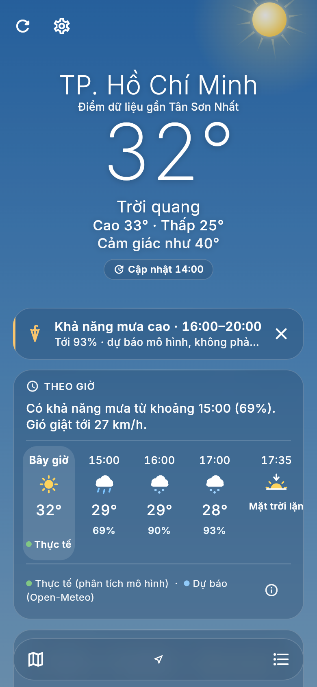
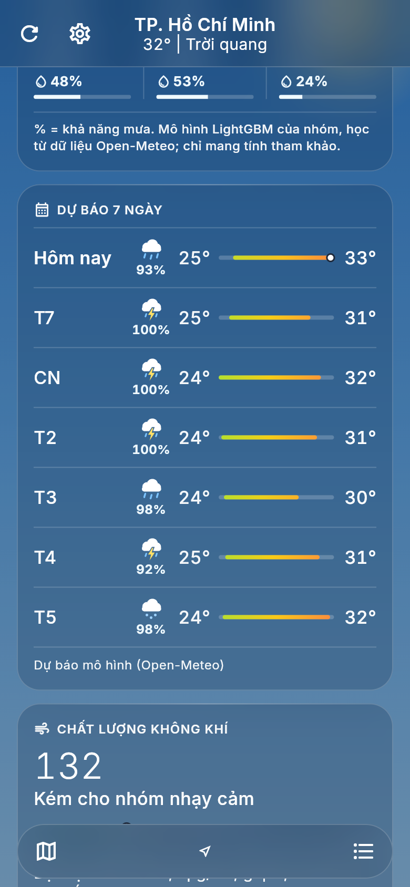
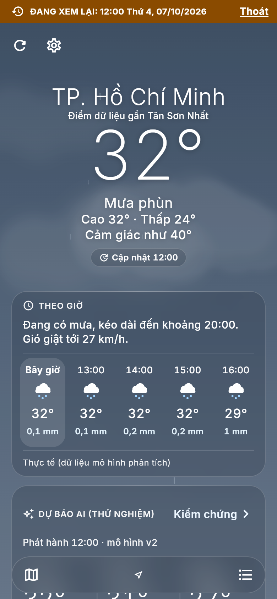
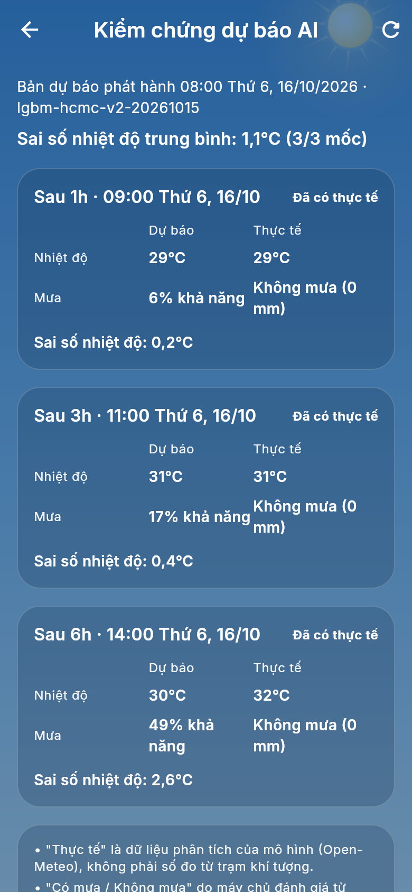
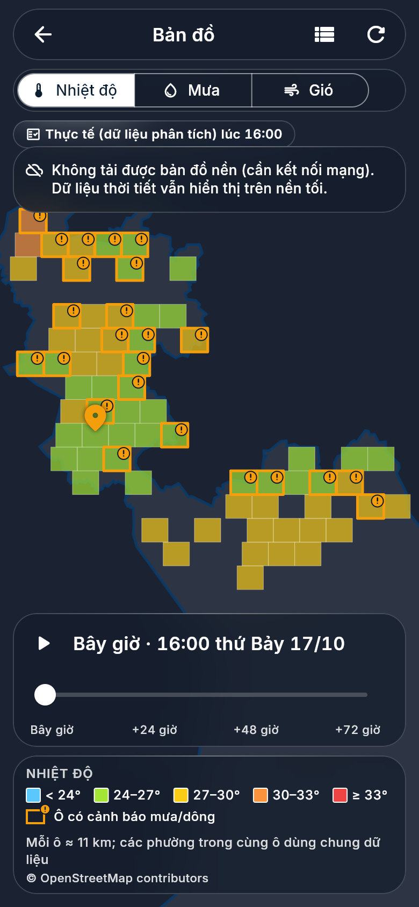
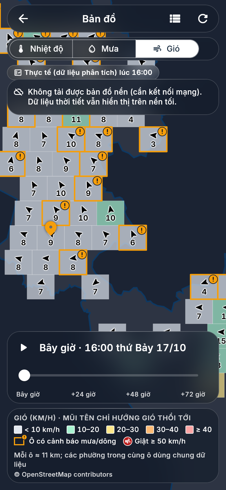
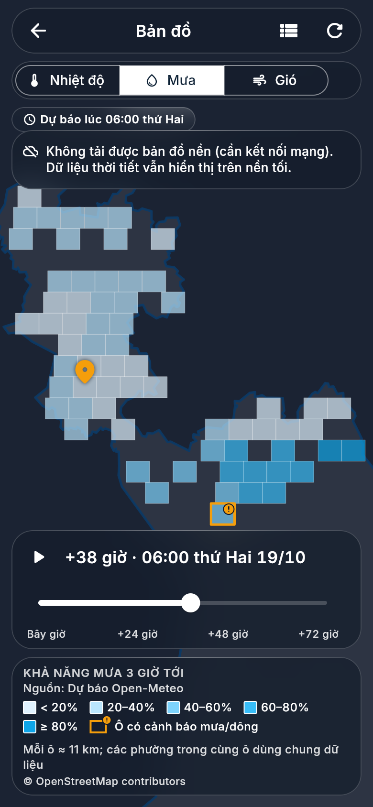
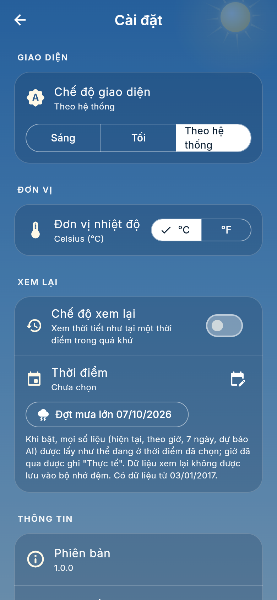

# Sky Weather – Ứng dụng thời tiết TP. Hồ Chí Minh

Đồ án sinh viên: ứng dụng Flutter (Android, web, iOS) hiển thị thời tiết cho **TP.HCM mới** (sau sáp nhập 2025 với Bình Dương và Bà Rịa – Vũng Tàu), lấy dữ liệu từ backend FastAPI của nhóm. Dự báo live dùng LightGBM riêng, direct 1–168 giờ với 6 mục tiêu; v3 1/3/6 giờ vẫn là luồng AI ngắn hạn riêng.

## Cập nhật 19/10/2026: Dự báo riêng thử nghiệm

- Đã huấn luyện thật **67 ô, 6 mục tiêu**, phiên bản `lgbm-direct-168h-20261019T105854Z`; 39,16 giây, peak RSS 259,9 MiB, 2 luồng. `backend/models/long_range/` chứa metadata, evaluation và sáu model `.txt`; `trained_through = 2024-12-24T16:00:00+07:00`.
- Live hourly/daily/map/thời tiết dọc tuyến dùng AI riêng cho tương lai, **không fallback NWP/khí hậu**. Current/đầu vào và AQ vẫn dùng nguồn ngoài có chủ đích. `EXTERNAL_FORECAST_ENABLED=0` mặc định; bật `1` chỉ tải dự báo ngoài tham chiếu, không chuyển nguồn phục vụ live.
- Nhãn nguồn `historical-forecast-api` là đầu ra mô hình bên ngoài, **không phải số đo trạm**. Chia thời gian rời nhau, giữ issue và issue+168h trong cùng split; held-out không chứng minh chất lượng vận hành thực tế.
- Test overall: MAE nhiệt độ 0,9418 °C; Brier mưa 0,129114. Ngày 7: MAE gió 3,2723 km/h kém khí hậu 3,2267; Brier mưa 0,126045 kém 0,124295; MAE nhiệt độ 0,9719 °C chỉ nhỉnh hơn khí hậu 1,0062. Không suy ra phần trăm chính xác.
- Mưa giờ **chưa hiệu chuẩn**. Daily AI trả `rain_day_probability = null` đến khi có mô hình/hiệu chuẩn sự kiện ngày riêng; không lấy max xác suất giờ làm phần trăm ngày. Tổng mưa ngày vẫn cộng lượng mưa giờ. UV/AQI/gió giật tương lai chưa được hỗ trợ, trả `null`.
- Bundle giữ current nếu có; dự báo không sẵn sàng trả mảng tương ứng `[]` và `forecast_error`, không gắn nguồn fallback giả. `/weather/forecast-status` trả `experimental` và tóm tắt evaluation. Replay là `historical_reference`, **không phải backtest**; AI outlook map bị chặn nếu issue không sau `trained_through`.
- Bằng chứng leader bàn giao: `ingest.py --location tsn` đã chạy khoảng **18:06 ngày 19/10/2026 (+07)** trên DB thật; đầu vào đến 18h, bundle **48 giờ + 7 ngày**, nguồn `observed` + `ai`, `forecast_error=None`. Các ô khác vẫn có thể cũ cho đến khi ingest; không tuyên bố toàn vùng đã cập nhật.
- Home có overview/focus responsive, mobile navigation có nhãn, desktop rail, tab **Dự báo / Điều kiện**, trạng thái nguồn/lỗi và giảm chuyển động. Route thiếu coverage không kết luận an toàn; backend đã chạy lại **290 test đạt**. Chưa xác minh đầy đủ trên thiết bị thật.

Chi tiết: [docs/self_forecast_upgrade.md](docs/self_forecast_upgrade.md). Kết quả v3 và test cũ bên dưới là lịch sử, không phải xác minh hoàn tất đợt nâng cấp này.

- Phạm vi: **168 phường/xã/đặc khu**, gộp thành **67 ô lưới** của Open-Meteo (các phường cùng rơi vào một ô lưới dùng chung một chuỗi dữ liệu). Ngoài ra có điểm `tsn` (gần Tân Sơn Nhất, điểm huấn luyện ban đầu), là alias của ô `om-10.7909-106.6313`.
- Danh sách và ranh giới phường/xã: OpenStreetMap (© OpenStreetMap contributors, ODbL), xem [backend/data/locations/SOURCES.md](backend/data/locations/SOURCES.md).
- Đầu vào thời tiết/AQ: nguồn ngoài qua backend, theo giờ, múi giờ GMT+7. Backend có lịch ingest mỗi giờ (phút 05) cho 68 chuỗi (67 ô + `tsn`); lịch chạy không bảo đảm mọi ô đã mới. Tương lai live do mô hình riêng sinh.
- Đây là **dữ liệu mô hình**, không phải số đo trạm. Dự báo AI chỉ là **thử nghiệm**. Cảnh báo trong app không phải cảnh báo chính thức; cảnh báo chính thức xem tại Đài KTTV khu vực Nam Bộ.
- Mã nguồn: https://github.com/chigiabao/SKYAPP
- Báo cáo chi tiết: [docs/bao_cao.md](docs/bao_cao.md). Câu hỏi bảo vệ: [docs/cau_hoi_bao_ve.md](docs/cau_hoi_bao_ve.md).

## Kiến trúc

```
+---------------------------+        HTTP/JSON        +-----------------------------+
|  Ứng dụng Flutter         |  ------------------->   |  Backend FastAPI (Python)   |
|  sky_weather_app          |  <-------------------   |  main.py (lịch ingest/giờ)  |
|  - Provider (trạng thái)  |                         |  routers/weather.py         |
|  - Cache offline          |                         |  routers/locations.py       |
|  - flutter_map (OSM)      |                         |  routers/route.py (OSRM)    |
|  - Android / web / iOS    |                         |  routers/auth.py, sync.py   |
|                           |                         |  routers/feedback.py        |
|                           |                         |  routers/monitor.py         |
|                           |                         |  ai_model.py                |
+---------------------------+                         +--------------+--------------+
                                                                     |
                                     +-------------------------------+--------------+
                                     |                                              |
                          +----------v----------+                     +-------------v------------+
                          | SQLite weather.db   |                     | LightGBM direct 168h     |
                          | 68 chuỗi đầu vào,   |                     | models/long_range/       |
                          | AQI, phường/xã,     |                     | v3/v2: AI ngắn hạn riêng |
                          | ô lưới              |                     | không fallback live     |
                          +----------^----------+                     +-------------^------------+
                                     |                                              |
                    ingest.py (đầu vào ngoài, mỗi giờ)        scripts/train_long_range.py
                                                              (v3: train_global_v3.py)
                          scripts/backfill_history.py  -->  data/history/cells_history.db
                          (lịch sử theo ô, nhãn mô hình ngoài cho ML)
```

## Cấu trúc thư mục

```
sky_weather_app/
├── lib/                          # ứng dụng Flutter (config, models, providers, screens, services, ui, widgets, utils)
├── test/                         # test Flutter
├── android/ ios/ web/ ...        # nền tảng Flutter
├── .github/workflows/ios-ipa.yml # CI: test, build IPA chưa ký, web, apk debug
├── tool/
│   └── cdp_screenshot.mjs        # chụp màn hình bản web qua Chrome DevTools Protocol
├── backend/                      # FastAPI + SQLite + mô hình
│   ├── main.py                   # khởi tạo app, /health, lịch ingest hằng giờ
│   ├── routers/weather.py        # các endpoint /weather/*
│   ├── routers/locations.py      # /locations/* (danh sách, tìm kiếm, GPS, GeoJSON)
│   ├── routers/admin.py          # /admin/ingest (localhost hoặc ADMIN_TOKEN)
│   ├── routers/route.py          # /route: tuyến OSRM + thời tiết dọc tuyến
│   ├── routers/auth.py, sync.py  # tài khoản tuỳ chọn, /me, /privacy
│   ├── routers/feedback.py       # /feedback (verified = false)
│   ├── routers/monitor.py        # /admin/monitor, /admin/retrain, /admin/rollback
│   ├── ingest.py                 # cập nhật đầu vào/AQ; dự báo ngoài chỉ opt-in tham chiếu
│   ├── long_range_model.py       # direct 1–168h, không fallback
│   ├── ai_model.py               # tạo đặc trưng + suy luận v2/v3 (dùng chung với huấn luyện)
│   ├── convert_excel_to_sqlite.py
│   ├── scripts/
│   │   ├── build_locations.py    # tạo danh sách phường/xã, ranh giới, ô lưới từ OSM
│   │   ├── backfill_history.py   # tải lịch sử theo ô (ngân sách API, chạy tiếp được)
│   │   ├── train_long_range.py   # huấn luyện/đánh giá 6 mục tiêu direct 1–168h
│   │   ├── train_global_v3.py    # huấn luyện + đánh giá mô hình v3
│   │   ├── train_global_v3_ext.py # hiệu chuẩn mưa, mục tiêu mới + cổng phục vụ (khoảng p10–p90 cũ)
│   │   └── train_global_v3_interval.py # khoảng nhiệt độ 90% (q05/q95 + CQR), thay khoảng p10–p90
│   ├── tests/                    # pytest
│   ├── data/
│   │   ├── weather.db
│   │   ├── locations/            # locations.json, cells.json, *.geojson, SOURCES.md
│   │   └── history/              # cells_history.db (dữ liệu huấn luyện v3)
│   └── models/
│       ├── *.pkl, *.json         # mô hình v2 (1 điểm tsn)
│       ├── long_range/           # metadata.json, evaluation.json và 6 model .txt
│       └── v3/                   # mô hình v3 toàn cục, metadata_v3.json, evaluation_v3.json, extension_v3.json, per_cell_metrics*.csv
├── notebooks/
│   ├── weather_forecasting.ipynb # v2: EDA, huấn luyện, đánh giá tại tsn
│   ├── global_model.ipynb        # v3: kiểm tra dữ liệu, rò rỉ, kết quả theo ô, spatial holdout
│   └── figures/                  # hình xuất từ notebook
├── data/                         # file Excel gốc (không chỉnh sửa)
├── docs/                         # báo cáo, câu hỏi bảo vệ
├── screenshots/                  # ảnh chụp ứng dụng
└── (ngoài thư mục này) ../Chuc nang/1.docx   # đề bài: 11 nhóm chức năng
```

## Cách chạy

### 1. Backend

```bash
cd backend
pip install -r requirements.txt
python -m uvicorn main:app --host 0.0.0.0 --port 8000
```

- Kiểm tra: mở `http://localhost:8000/health` hoặc tài liệu API tại `http://localhost:8000/docs`.
- Khi khởi động, backend chạy ingest một lần rồi lặp lại mỗi giờ vào phút 05. Mặc định `EXTERNAL_FORECAST_ENABLED=0` vẫn cập nhật đầu vào/AQ ngoài, không tải dự báo ngoài. Bật `1` chỉ để tham chiếu, không fallback live.
- `--host 0.0.0.0` chỉ cần khi chạy app trên điện thoại thật.
- Test: `cd backend && python -m pytest tests -q` (chạy 2026-10-18 00:15: **196 passed**, 56 giây).

### 2. Backfill lịch sử theo ô (tùy chọn, dùng cho huấn luyện v3)

```bash
cd backend
python scripts/backfill_history.py --status        # xem độ phủ và mức dùng API
python scripts/backfill_history.py --max-hours 3   # chạy tối đa 3 giờ, lần sau chạy tiếp từ chỗ dừng
```

Script ghi vào file riêng `backend/data/history/cells_history.db`, giữ dưới ngân sách gọi API theo phút/giờ/ngày của Open-Meteo (mặc định 500 / 4500 / 9000), tự nghỉ khi hết ngân sách.

### 3. Ứng dụng Flutter

```bash
# chạy tại thư mục gốc (sky_weather_app)
D:\flutter\bin\flutter pub get
D:\flutter\bin\flutter run
D:\flutter\bin\flutter test --exclude-tags golden   # chạy 2026-10-18 00:17: 457 passed, 4 skipped
```

- **Android emulator**: mặc định gọi `http://10.0.2.2:8000` (địa chỉ của máy host nhìn từ emulator), không cần cấu hình.
- **Điện thoại thật** (cùng mạng Wi‑Fi với máy chạy backend):
  ```bash
  D:\flutter\bin\flutter run --dart-define=API_BASE_URL=http://<IP-máy-tính>:8000
  ```
- Chạy trên điện thoại thật qua IP LAN: dùng bản **debug/profile**. Bản `--release` chỉ cho phép HTTP tới 10.0.2.2/localhost/127.0.0.1 (network_security_config), nên sẽ không kết nối được tới IP LAN.
- Mở cổng 8000 trên Windows Firewall cho mạng Private và chạy backend với `--host 0.0.0.0`.
- Trước demo kiểm tra `/health`, `/weather/forecast-status` và bundle tại từng địa điểm; cần 48 giờ đầu vào liên tục, giờ mới nhất trong 3 giờ gần đây. Thiếu/cũ có thể làm dự báo không sẵn sàng; không có khí hậu dự phòng live.
- **Đổi máy chủ lúc chạy:** vào **Cài đặt → Máy chủ dữ liệu**, nhập địa chỉ (ví dụ `http://192.168.1.10:8000`) và kiểm tra kết nối. Địa chỉ được lưu trên máy và ưu tiên hơn giá trị `API_BASE_URL` lúc build, nên không cần build lại.
- Cấu hình nằm tại `lib/config/api_config.dart`.
- Golden test (so ảnh chụp, gắn tag `golden`) phụ thuộc font và hệ điều hành nên được tách khỏi lệnh test chính.

### 4. Build Android

```bash
# chạy tại thư mục gốc (sky_weather_app)
D:\flutter\bin\flutter build apk --debug

# release khuyến nghị (arm64, rút gọn tên + tách ký hiệu gỡ lỗi):
D:\flutter\bin\flutter build apk --release --target-platform android-arm64 --obfuscate --split-debug-info=build/debug-info --dart-define=API_BASE_URL=https://your-backend.example
```

Release cần `android/key.properties` và keystore thật, xem `android/key.properties.example`.
Thiếu khóa thì build release dừng rõ lỗi, không dùng khóa debug thay thế. Không commit
keystore hoặc mật khẩu. APK debug không cần cấu hình ký release. Xem thêm
[kiểm chứng và checklist mobile](docs/mobile_release.md).

Giữ thư mục `build/debug-info` của mỗi bản phát hành để giải mã stack trace (`flutter symbolize`). Font Inter trong `assets/fonts` đã được subset (Latin + tiếng Việt + ký hiệu, giữ `tnum`) để giảm kích thước.

`android/gradle.properties` đặt `kotlin.incremental=false`: pub cache nằm ở ổ C còn dự án ở ổ D, biên dịch Kotlin tăng dần lỗi khi đường dẫn khác ổ đĩa nên phải tắt.

Bundle id / applicationId: `com.skyweather.app` (iOS và Android dùng chung). Bản Android cài trước đây với id `com.example.sky_weather_app` sẽ là một ứng dụng riêng, cần gỡ thủ công.

### 4b. Web

```bash
D:\flutter\bin\flutter run -d chrome          # API mặc định http://localhost:8000
D:\flutter\bin\flutter build web              # kết quả ở build/web
```

- Trên web, API mặc định là `http://localhost:8000`. Ghi đè bằng `--dart-define=API_BASE_URL=...` như các nền tảng khác.
- Backend đã bật CORS cho mọi origin (`backend/main.py`).
- Thông báo hệ thống và chạy nền (workmanager) không có trên web: app dùng bản Noop, cảnh báo vẫn hiện trong ứng dụng.
- Trình duyệt chỉ cho dùng GPS khi trang mở qua **https** hoặc **localhost**. Nếu mở qua `http://<IP LAN>`, app báo rõ là bị chặn; khi đó hãy tìm địa điểm theo tên.

### 4c. Build và ký iOS

1. Push code lên nhánh `main` của GitHub. Workflow `.github/workflows/ios-ipa.yml` sẽ tự chạy. Có thể chạy tay ở **Actions → Build iOS / Web / Android → Run workflow** và nhập `api_base_url`.
2. Chờ job `ios` xong (runner macOS), mở lần chạy đó và tải artifact **SkyWeather-unsigned-ipa** (file zip chứa `SkyWeather-unsigned.ipa`). Cũng có artifact web và apk debug.
3. IPA này **chưa ký, không cài trực tiếp được**. Cần signing identity và provisioning profile phù hợp. Thực hiện ký trên môi trường Apple được quản lý bởi chủ tài khoản; không đưa Apple ID, chứng chỉ hoặc mật khẩu vào repo/chat.

Giới hạn của Apple ID miễn phí:
- Ứng dụng **hết hạn sau 7 ngày**, phải ký và cài lại (dữ liệu trong app vẫn giữ nếu cài đè cùng bundle id).
- Mỗi Apple ID cài tối đa 3 app tự ký cùng lúc.
- Không có push notification từ xa và không có App Groups. Thông báo cục bộ (cảnh báo, nhắc hoạt động) vẫn hoạt động.
- Chạy nền dùng BGAppRefreshTask: iOS tự quyết định thời điểm chạy (thường vài giờ một lần, có thể không chạy nếu ít mở app), nên không được đúng mỗi giờ như Android.

**Đặt `API_BASE_URL`** (giá trị được nhúng lúc build, nên đổi địa chỉ thì phải build lại):
- Nhập vào ô `api_base_url` khi chạy tay workflow, hoặc tạo biến repo **Settings → Secrets and variables → Actions → Variables → `API_BASE_URL`** (áp dụng cho mỗi lần push).
- IP LAN: `http://192.168.x.x:8000`. iPhone và máy chạy backend phải cùng mạng Wi‑Fi; lần đầu iOS hỏi quyền "Mạng cục bộ", hãy chọn Cho phép.
- Tunnel https (dùng được cả khi khác mạng): `cloudflared tunnel --url http://localhost:8000` rồi dùng địa chỉ `https://xxx.trycloudflare.com` mà lệnh in ra. Địa chỉ này đổi sau mỗi lần chạy lại cloudflared.
- Workflow iOS mới yêu cầu URL backend thật, từ input hoặc biến repo; từ chối URL loopback/emulator. Khi chạy cục bộ, iOS mặc định `http://localhost:8000` cho simulator; iPhone thật cần URL HTTPS hoặc máy chủ LAN và có thể đổi ở **Cài đặt → Máy chủ dữ liệu** mà không build lại.

**App Transport Security**: dùng `NSAllowsLocalNetworking`, không tắt ATS toàn cục. Ưu tiên HTTPS; HTTP LAN chỉ phục vụ thử nghiệm trong mạng tin cậy và cần kiểm tra trên phiên bản iOS đích. Không gửi thông tin đăng nhập qua HTTP. Tác vụ nền nạp lại URL backend đã lưu trước khi gọi API.

**Trạng thái kiểm chứng iOS:** kết quả workflow ngày 17/10/2026 chỉ thuộc phiên bản cũ. Thay đổi hiện tại mới kiểm tra source/config trên Windows; chưa chạy lại Xcode/XCTest/CI hay iPhone thật. Workflow đã thêm XCTest simulator trước bước IPA; chưa có kết quả của lượt này. Không tự push hoặc kích hoạt workflow trong lượt sửa local.

Trên iPhone: chế độ chuyến đi chạy nền nhờ `UIBackgroundModes: location` (quyền "Khi dùng ứng dụng" là đủ, iOS hiện thanh chỉ báo vị trí); token đăng nhập lưu trong Keychain.

**Widget màn hình chính (iOS): chưa làm.** Android có widget (`WeatherWidgetProvider`, layout XML: nhiệt độ, trạng thái, khả năng mưa 3 giờ, tên địa điểm đầu tiên; cập nhật khi app tải dữ liệu và khi tác vụ nền chạy). Trên iOS, Dart đã gọi `HomeWidget.saveWidgetData` (lỗi được bỏ qua khi chưa có extension) nhưng chưa có WidgetKit extension, vì phải sửa `ios/Runner.xcodeproj/project.pbxproj` mà không có Mac để thử, một lỗi sẽ làm hỏng build IPA. Khi có Mac:
1. Mở `ios/Runner.xcworkspace` bằng Xcode → **File → New → Target → Widget Extension** (ví dụ tên `SkyWeatherWidget`, bỏ chọn Live Activity / Configuration Intent).
2. Bật capability **App Groups** cho cả `Runner` và extension, cùng một id (ví dụ `group.com.skyweather.app`). Lưu ý: Apple ID miễn phí không có App Groups (xem trên), nên widget iOS cần tài khoản Apple Developer trả phí.
3. Trong Dart gọi `HomeWidget.setAppGroupId('group.com.skyweather.app')` trước `saveWidgetData`, và thêm `HomeWidget.updateWidget(iOSName: 'SkyWeatherWidget')` trong `lib/services/home_widget_service.dart`.
4. Trong extension, đọc `UserDefaults(suiteName: "group.com.skyweather.app")` các khóa `sw_place`, `sw_temp`, `sw_condition`, `sw_rain3h` để vẽ SwiftUI view.
5. Đặt Deployment Target của extension bằng của Runner, rồi build thử trên máy trước khi push.

### 4d. Git

- `.gitignore` đã loại bỏ `build/`, `.dart_tool/`, `__pycache__`, `.pytest_cache`, `backend/data/*.db`, `backend/data/history/` và `*.backup-*.db`. GitHub chặn file lớn hơn 100 MB.
- `backend/data/locations/` và `backend/models/` vẫn được commit. Hiện file lớn nhất khoảng 7 MB.
- Các job build cần job `test` đạt analyze và test không-golden. Riêng golden (ảnh Windows) không chặn vì font/khử răng cưa Linux có thể khác; workflow chạy riêng `--tags golden` ở bước không chặn.

### 5. Huấn luyện lại mô hình

Mô hình tương lai live dùng lệnh riêng, chạy từ `backend/`:

```bash
python scripts/train_long_range.py --train --max-seconds 180
```

Đây là lệnh tái lập, không cam kết thời gian trên máy khác. Xem [tài liệu nâng cấp](docs/self_forecast_upgrade.md). `/admin/retrain` vẫn là pipeline **v3 riêng**, không cập nhật long-range. Pipeline v3 được giữ lại:

```bash
pip install numpy pandas lightgbm joblib scikit-learn matplotlib jupyter
cd backend && python scripts/train_global_v3.py   # v3, ghi vào backend/models/v3/
python scripts/train_global_v3_ext.py             # chạy ngay sau: hiệu chỉnh mưa, mục tiêu mới
python scripts/train_global_v3_interval.py        # chạy cuối: khoảng nhiệt độ 90% (khoảng 30 phút)
cd ../notebooks && jupyter notebook global_model.ipynb
```

`global_model.ipynb` đọc kết quả của script (đặt `RETRAIN = True` để chạy lại). `weather_forecasting.ipynb` là mô hình v2 một điểm. Khởi động lại backend sau khi huấn luyện lại.

## Endpoint

Các endpoint theo địa điểm nhận `location_id`: id phường/xã (từ `/locations`), một `cell_id`, hoặc `tsn` (mặc định); map/meta và forecast-status không theo tham số này. Hầu hết nhận thêm `at` (ISO 8601) để xem lại quá khứ; đó là tham chiếu lịch sử, không phải backtest AI.

| Phương thức | Đường dẫn | Mô tả |
|---|---|---|
| GET | `/health` | Trạng thái API, DB, lần ingest gần nhất; `cells`: tổng số ô, số ô có dữ liệu trong 3 giờ qua, danh sách ô cũ |
| GET | `/locations` | 168 phường/xã/đặc khu + `tsn` (id, tên, loại, tỉnh cũ, tọa độ, `cell_id`) |
| GET | `/locations/search?q=` | Tìm theo tên, có dấu hoặc không dấu, tối đa 20 kết quả |
| GET | `/locations/nearest?lat=&lon=` | Phường/xã chứa điểm GPS (hoặc gần nhất); ngoài ranh giới trả 404 "Ngoài vùng hỗ trợ (TP.HCM)" |
| GET | `/locations/boundary` | Ranh giới TP.HCM mới (GeoJSON, đã đơn giản hóa, © OSM) |
| GET | `/locations/wards` | Ranh giới từng phường/xã (GeoJSON, © OSM) |
| GET | `/locations/current` | Cũ: điểm cố định gần Tân Sơn Nhất |
| GET | `/weather/current` | Giờ mới nhất của chuỗi dữ liệu, kèm chất lượng không khí nếu có |
| GET | `/weather/hourly?hours=24` | Live: giờ đã có dữ liệu `observed`, tương lai `ai` direct tối đa 168h từ issue; thiếu phủ trả 503, không fallback NWP/khí hậu |
| GET | `/weather/daily?days=7` | Tổng hợp giờ; tổng mưa cộng lượng mưa giờ, xác suất ngày AI `null`. Query nhận 1–14 ngày nhưng model chỉ 168h từ issue; vượt phủ trả 503 |
| GET | `/weather/bundle?hours=48&days=7` | Giữ current nếu có; phần dự báo không sẵn sàng trả `[]` và `forecast_error`; provider live `sky_weather_ai`, replay `historical_reference` |
| GET | `/weather/forecast-status` | Khả năng artifact, `experimental=true`, evaluation held-out overall/theo ngày; không bảo đảm đầu vào mọi ô đang mới |
| GET | `/weather/history?start_date=&end_date=` | Dữ liệu theo giờ trong khoảng, tối đa 365 ngày |
| GET | `/weather/ai-forecast` | LightGBM: nhiệt độ và xác suất mưa (≥ 0,1 mm) sau 1/3/6 giờ từ 48 giờ dữ liệu cuối; kèm `model_version` và `evaluation` (kết quả test tại ô đó) |
| GET | `/weather/ai-verify` | Dự báo AI phát hành tại `at` (mặc định 6 giờ trước) đặt cạnh giá trị thực tế |
| GET | `/weather/map?offset_hours=0` | Mỗi ô lưới (67 mục, alias `tsn` được gộp) tại khung hiện tại + `offset_hours` (0–72): nhiệt độ, gió (`wind_speed`, `wind_direction`, `wind_gusts`), lượng mưa, mưa 3 giờ sau khung, `alert` (mã dông hoặc ≥ 10 mm trong 3 giờ; theo mô hình, không chính thức), `source`, `valid_time`. Chế độ xem lại (`at`) chỉ cho `offset_hours=0`, khác thì trả 400 |
| GET | `/weather/map/meta` | `now`, `max_offset_hours` (tối đa 72; 0 khi xem lại), `issued_at` đầu vào phát hành AI; phụ thuộc model và độ mới đầu vào |
| GET | `/route?from_lat=&from_lon=&to_lat=&to_lon=&depart_at=&profile=` | Tuyến đường từ OSRM (backend gọi; `profile` = `driving` / `cycling` / `foot`) kèm thời tiết khoảng mỗi 2 km theo giờ đến dự kiến, `alert` theo mẫu |
| POST | `/route/along-weather` | Body `{geometry, depart_at?, duration_min?, profile?}`: làm mới thời tiết dọc tuyến app đã có, không gọi lại OSRM |
| POST | `/feedback` | Báo lỗi / góp ý / báo dự báo sai (`kind` = `bug` / `suggestion` / `wrong_forecast`); không cần đăng nhập; 10 lần/giờ mỗi IP; trả `verified: false` |
| GET | `/feedback/summary` | Thống kê phản hồi theo loại, theo ô, tỉ lệ báo sai dự báo mưa (quản trị) |
| POST | `/auth/register` | Tạo tài khoản tuỳ chọn (email, mật khẩu 8–128 ký tự) |
| POST | `/auth/login` | Đăng nhập, trả token Bearer (hạn 30 ngày); tối đa 5 lần sai mỗi 15 phút |
| POST | `/auth/logout` | Huỷ token hiện tại |
| GET | `/me` | Thông tin tài khoản (cần `Authorization: Bearer <token>`) |
| DELETE | `/me` | Xoá tài khoản cùng mọi dữ liệu (cần mật khẩu) |
| GET / PUT / DELETE | `/me/data` | Tài liệu đồng bộ có `version`; `PUT` gửi `base_version`, trả 409 kèm bản hiện tại khi xung đột |
| GET | `/me/export` | Xuất toàn bộ dữ liệu tài khoản dạng JSON |
| GET | `/privacy` | Chính sách quyền riêng tư: lưu gì, giữ bao lâu, xoá thế nào |
| POST | `/admin/ingest` | Chạy ingest thủ công |
| GET | `/admin/ingest/log` | Nhật ký các lần ingest gần nhất |
| GET | `/admin/monitor?days=7` | Chất lượng AI đã phát hành so với thực tế, cảnh báo nhầm / bỏ sót, lỗi ingest, số lần gọi API (Open-Meteo, OSRM), phản hồi mới |
| POST | `/admin/retrain` | Chạy nền tuần tự `train_global_v3.py`, `train_global_v3_ext.py`, rồi `train_global_v3_interval.py` vào `models/v3_candidate/`; chỉ xét thay `models/v3` khi cả ba bước thành công và ứng viên tốt hơn (bản cũ giữ ở `models/v3_prev/`); 409 nếu đang có lần chạy khác |
| GET | `/admin/retrain/{job_id}` | Trạng thái một lần huấn luyện lại |
| POST | `/admin/rollback` | Hoán đổi `models/v3` và `models/v3_prev` |

Mọi `/admin/*` (và `/feedback/summary`) chỉ nhận yêu cầu từ localhost, hoặc cần header `X-Admin-Token` nếu đặt biến môi trường `ADMIN_TOKEN`.

**Phạm vi v3 lịch sử:** mô tả khoảng 90%, gió giật và thẻ Home trong đoạn kế
tiếp chỉ thuộc luồng v3 ngắn hạn. Không áp dụng các kết quả đó cho long-range
168h hoặc coi là xác minh Home mới; long-range chưa có prediction interval
hay dự báo gió giật.

`/weather/ai-forecast` trả thêm khoảng nhiệt độ `temperature_low`, `temperature_high` với `interval_level` = 0,9 (khoảng 90%), câu `uncertainty_note` và các mục tiêu đã qua cổng kiểm chứng (`humidity`, `wind_speed`, `wind_gusts`, `precipitation_mm`; danh sách ở `enabled_targets`) khi có `backend/models/v3/extension_v3.json`. `temperature_p10`, `temperature_p90` chỉ giữ cho client cũ và bằng đúng `temperature_low`, `temperature_high`. Trên test từ 2025, khoảng 90% phủ 91,1 / 90,2 / 90,4% ở tầm 1 / 3 / 6 giờ (chi tiết: `docs/bao_cao.md`, mục 5.11). Thẻ AI trên trang chủ hiển thị khoảng (ghi "khoảng 90%") và các mục tiêu đã bật.

`/admin/retrain` đã chạy bước hiệu chỉnh khoảng nhiệt độ 90% bằng `train_global_v3_interval.py` sau hai bước huấn luyện trước đó; nếu bước này lỗi, ứng viên không được thay mô hình hiện tại. Nguồn: `backend/routers/monitor.py` và các ca kiểm thử trong `backend/tests/test_monitor.py`.

Trung bình nhiều năm chỉ còn dùng cho tham chiếu replay và baseline đánh giá, **không fallback tương lai live**. Cơ chế lịch sử: ô đủ dữ liệu dùng khí hậu riêng; ô thiếu dùng của `tsn`. Replay map gọi `long_range_model.predict` có guard; issue không sau `trained_through` không có AI outlook, không dùng dự đoán legacy bị rò rỉ.

## Ảnh chụp màn hình

Ảnh lịch sử chụp từ bản web, khung 390×844 (dữ liệu từ backend của nhóm); không phải bằng chứng xác minh UI mới ngày 19/10/2026.

| Trang chủ | Chi tiết | Xem lại 07/10 | Kiểm chứng AI |
|---|---|---|---|
|  |  |  |  |

| Bản đồ – nhiệt độ | Bản đồ – gió (phóng to) | Thanh thời gian +18 giờ | Cài đặt |
|---|---|---|---|
|  |  |  |  |

Ảnh bản đồ chụp bằng trình duyệt không có mạng nên nền OpenStreetMap hiện màu tối; trên máy có mạng, nền bản đồ hiển thị bình thường.
