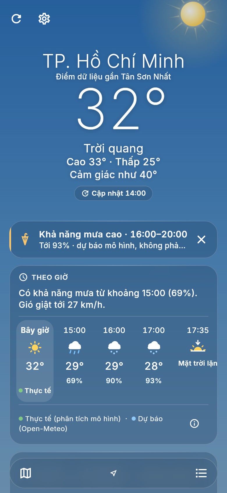
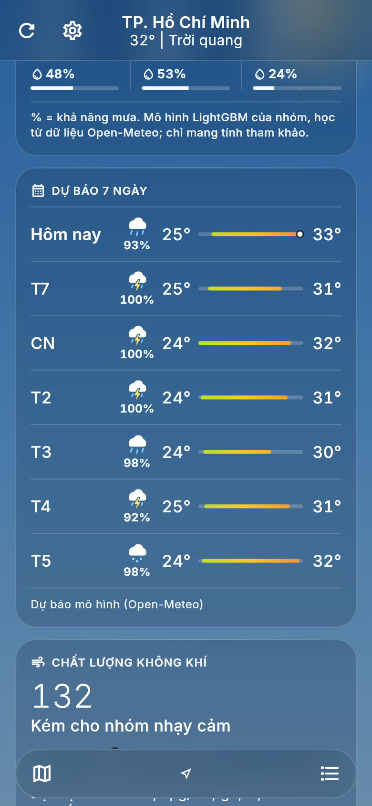
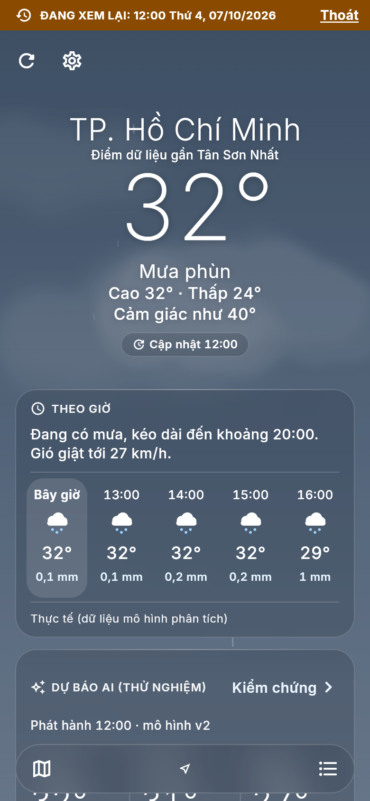
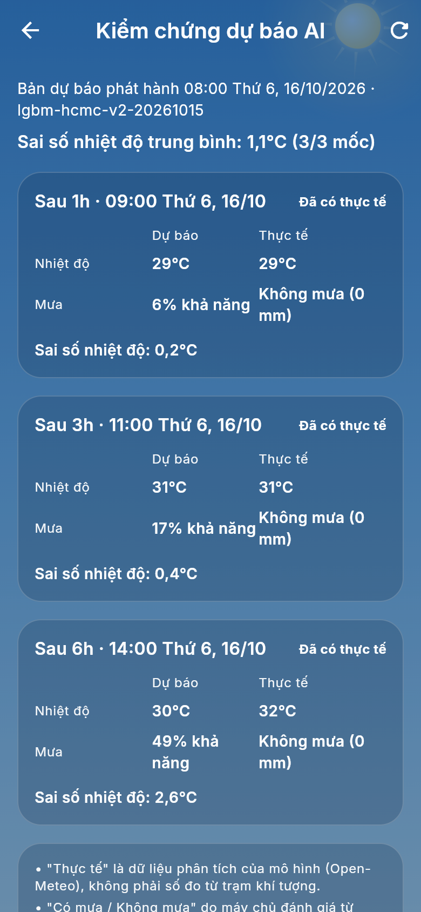
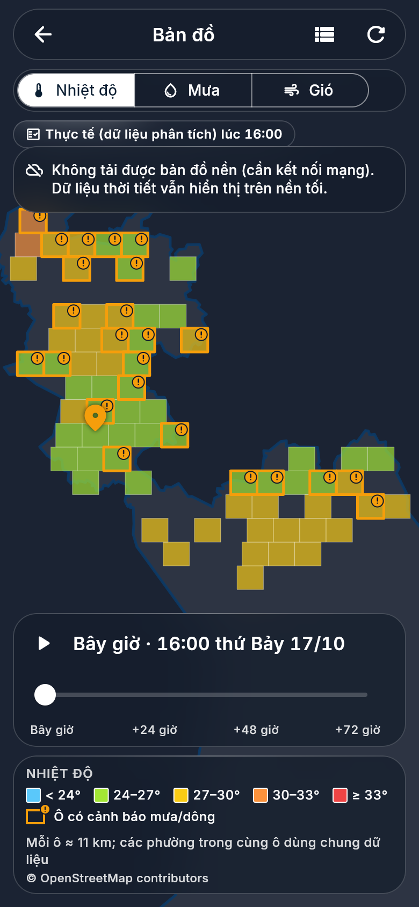
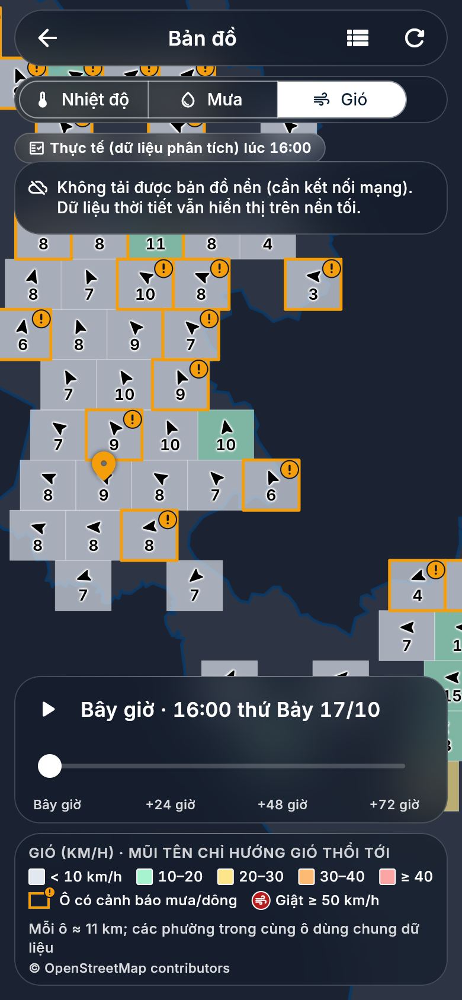
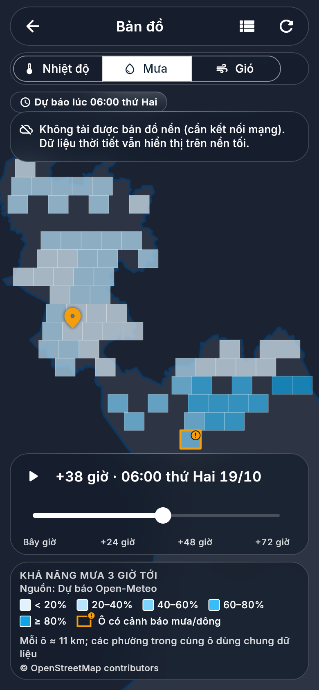
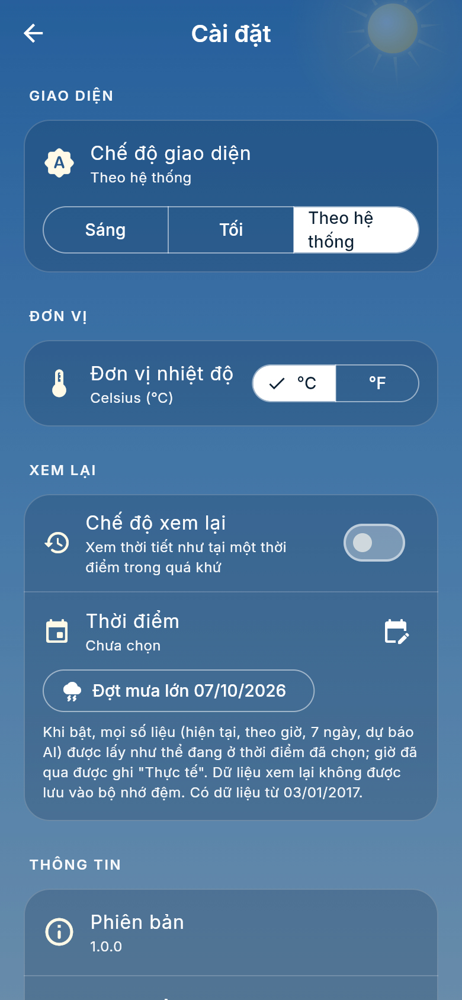

# Sky Weather – Ứng dụng thời tiết TP. Hồ Chí Minh

Đồ án sinh viên: ứng dụng Flutter (Android, web, iOS) hiển thị thời tiết cho **TP.HCM mới** (sau sáp nhập 2025 với Bình Dương và Bà Rịa – Vũng Tàu), lấy dữ liệu từ backend FastAPI của nhóm. Dự báo live dùng LightGBM riêng, direct 1–168 giờ với 6 mục tiêu; model đang phục vụ là **long-range v2**, có thể phối hợp v3 ở đúng các mốc 1/3/6 giờ theo serving policy.

## Trạng thái hiện tại (02/11/2026)

- **Thời tiết:** nhiệt độ, độ ẩm, gió, mây, xác suất và lượng mưa; dự báo giờ/ngày từ mô hình của nhóm. Current và đầu vào lịch sử/AQ lấy qua backend, không gọi API thời tiết trực tiếp từ Flutter. Giữ `EXTERNAL_FORECAST_ENABLED=0`; không fallback dự báo tương lai sang dịch vụ ngoài.
- **Bản đồ:** phạm vi dữ liệu gồm 168 phường/xã/đặc khu, quy về 67 ô lưới. Có lớp thời tiết và thanh thời gian; thời điểm dữ liệu tách biệt với thời điểm tải lại. Phạm vi địa lý đầy đủ không đồng nghĩa mọi ô đều có dữ liệu mới hoặc dự báo sẵn sàng.
- **Ra ngoài:** phân biệt điểm đi **A** và điểm đến **B**, tên địa điểm, giờ đi/đến và thời tiết hai đầu tuyến; tổng hợp nhiệt độ, độ ẩm, gió cùng mưa dọc tuyến khi có dữ liệu. Chỉ số thiếu không được biến thành 0 hoặc kết luận tuyến an toàn.
- **Trải nghiệm:** web và API chạy cùng origin; cache offline, tìm địa điểm/GPS, cài đặt đơn vị và giảm chuyển động; tài khoản, đồng bộ và khôi phục mật khẩu là tùy chọn.
- **Model phục vụ:** `backend/models/long_range_v2/`, phiên bản `lgbm-direct-168h-v2-20261031T071738Z`. Lớp khoảng dự báo tùy chọn ở `backend/models/long_range_v2_intervals/`; chỉ trả các chỉ số/dải thời gian đã qua cổng coverage.

### Kiểm chứng gần nhất

| Phạm vi | Kết quả đã xác minh | Môi trường |
|---|---|---|
| Backend regression trên GitHub Actions | **895 passed, 25 skipped**, coverage **89,93%** | Ubuntu, Python 3.12; commit `3858479`, workflow build lần **#13** |
| Backend trong môi trường mới, chỉ cài requirements | **895 passed, 25 skipped**, coverage **89,87%**; Ruff và `pip check` đạt | Windows, Python 3.14; không training |
| Flutter không gồm golden | **904 passed, 7 skipped**; analyzer đạt | Lượt kiểm tra local ngày 02/11/2026 |
| Backend Health Tests và golden | Job CI đã đạt | Commit `3858479`; không suy ra đã ký/cài được bản mobile |

CI backend đã bổ sung `psutil` trong `backend/requirements-dev.txt` để test hiệu chỉnh khoảng dự báo chạy được trên máy sạch. Các test dùng fixture huấn luyện được bỏ qua bằng `--skip-model-training`; không diễn giải số test đạt thành độ chính xác dự báo.

**Giới hạn:** dự báo vẫn là thử nghiệm, không phải cảnh báo khí tượng chính thức. UV/AQI/gió giật tương lai có thể không được model hỗ trợ; giao diện phải giữ trạng thái thiếu dữ liệu. Khoảng p10–p90 nhắm độ phủ 80%, còn lượng mưa có cận trên p90 một phía; coverage không phải phần trăm chính xác. Cửa sổ hiệu chỉnh có giao với cửa sổ từng dùng chọn model, nên cần đánh giá độc lập trước khi tin cậy vận hành. SMTP thật, backend public HTTPS, iOS signing/App Groups và thiết bị thật vẫn cần kiểm chứng riêng.

Xem [cách chạy](#cách-chạy), [triển khai](docs/deploy.md), [build Android/iOS](#4-build-android) và [hướng dẫn huấn luyện v2.1 thử nghiệm](notebooks/colab_train_v21/README.md). V2.1 chưa được đưa vào phục vụ.

<details>
<summary>Lịch sử kiểm chứng và cập nhật (19–26/10/2026)</summary>

Các số liệu/model bên dưới ghi lại từng thời điểm, không thay thế trạng thái hiện tại phía trên.

## Tiến độ hoàn thiện (26/10/2026)

- Nguồn trạng thái lịch sử: [docs/progress_20261026.json](docs/progress_20261026.json); tạo PDF local bằng `python tool/build_progress_pdf.py` (PDF nằm ngoài repository, không được phát hành kèm mã nguồn).
- Đã sửa freshness/expiry AI live, giới hạn fallback v2 ở TSN, kiểm tra serving policy và nạp fallback nguyên khối; ngày thiếu dữ liệu mưa không còn bị tính là ngày khô.
- Đã thêm khôi phục mật khẩu qua email (token một lần, hạn 15 phút, lưu hash, giới hạn yêu cầu/thử sai, thu hồi mọi phiên). Cần SMTP TLS theo `.env.example` và thử gửi email thật trước production.
- Trang chủ dùng thẻ AI thu gọn; cài đặt được phân nhóm với trang chi tiết, giữ đầy đủ tùy chọn cũ.
- Kiểm chứng mới: backend **789 passed, 15 skipped, 2 subtests passed** (không training); Flutter **753 passed, 7 skipped** không gồm golden; golden **16 passed**; HTTP contract FastAPI/Flutter **3 passed**. Analyzer và Ruff đạt. Logs ở `build/progress-*`.
- Chưa kiểm chứng Docker container (daemon chưa chạy), SMTP thật, iOS signing/WidgetKit và thiết bị thật. Không retrain hay ingestion, không triển khai production trong đợt này.

## Kiểm chứng trước đợt hoàn thiện (23/10/2026)

- **Backend FastAPI**: **680 passed, 2 subtests passed** (`python -m pytest -q -p no:warnings`), linter **Ruff sạch** (`All checks passed!`). Rate limit mặc định `RATE_LIMIT_PER_MINUTE=120`, hàm lấy IP chuẩn hóa chống spoofing header khi có proxy tin cậy (`TRUST_PROXY=1`), rate limit chặt 5 lần/giờ/IP cho đăng ký; router `backend/routers/weather.py` gọn sạch (< 30 dòng), không re-export nội bộ xuyên module.
- **Ứng dụng Flutter**: **749 passed, 7 skipped** (`flutter test`), `flutter analyze` **No issues found!**, golden tests nguyên vẹn. Toàn bộ 100% file mã nguồn Dart trong `lib/` đều $\le 700$ dòng (file lớn nhất 690 dòng).
- **AI/ML v3**: Repo thu gọn chỉ còn 1 bản v3 duy nhất (giảm 386,5 MB model trùng sang `build/model-archive/`); chính sách chọn model khách quan dựa trên `val_select` sạch (`compare_v3_20261023.json`), báo cáo coverage interval trung thực theo số đo thực tế trên test (88,48% / 88,11% / 89,33% cho 1h / 3h / 6h).
- **Nhật ký nâng cấp toàn diện**: [docs/nang_9_diem_log_20261023.md](docs/nang_9_diem_log_20261023.md).

## Lịch sử cập nhật

### Cập nhật dữ liệu và AI (22/10/2026)

- Đã bổ sung 4.824 hàng lịch sử cho 67 ô; tải 36 CSV quan trắc NOAA ISD và 14 CSV METAR IEM có dữ liệu, lưu riêng nguồn và checksum. Có model nhiệt độ thử nghiệm bằng nhãn trạm, learning curve và kiểm tra giai đoạn mới hơn.
- Chưa thay model phục vụ toàn app: model trạm chỉ có phạm vi ba điểm; 1h còn thua persistence, thử interval chưa đạt 90%, chưa có nhãn mưa giờ đủ điều kiện.
- Kiểm chứng lúc đó: 650 backend tests đạt, 15 skipped, 2 subtests; coverage runtime 89,39%; 4 live Flutter tests đạt. [Báo cáo nguồn dữ liệu, metrics và giới hạn](docs/archive/data_upgrade_20261022.md).

### Kiểm chứng tích hợp (22/10/2026)

- Backend 569 passed, 15 skipped, coverage runtime 88,73%; Flutter 733 passed, 7 skipped, coverage 83,90%; 16 golden và 3 test HTTP contract đạt. Analyzer và Ruff không issue. CI yêu cầu coverage tối thiểu 80%.
- Hoàn tất tách bốn màn hình chính, sửa trợ năng, bảo vệ log webhook/rate limit và cách đánh giá AI. Model ứng viên chưa được đưa vào phục vụ vì interval còn dưới mục tiêu và cần kiểm chứng lại.
- Kết quả, log và giới hạn: [docs/archive/continuation_20261022.md](docs/archive/continuation_20261022.md).

### Độ tin cậy vận hành (21/10/2026)

- Đã cập nhật live qua pipeline hiện có: tại 19:42 (+07), đầu vào tới **19:00 ngày 21/10/2026**, health `ready=true`, **68/68 ô mới**; bundle trả **48 giờ, 7 ngày**, `forecast_error=null`.
- Scheduler thử lại sớm một lần sau 5 phút khi lỗi/partial, sau đó về lịch HH:05. `/health.scheduler` cho biết đang chạy/chờ/tắt/chưa khởi động, lần chạy trước và lần chạy kế tiếp. Tắt lifespan sẽ không có scheduler.
- Ingest từ chối số không hữu hạn, mảng giờ sai, timestamp trùng và dữ liệu nhiệt độ rỗng. Một location lỗi trong batch không làm mất dữ liệu hợp lệ của các location khác.
- Tác vụ nền Flutter yêu cầu retry với lỗi mạng/timeout/408/429/5xx; không retry 401/403 hoặc dữ liệu không hợp lệ. Kết quả từng địa điểm được giữ, thông báo không bị gửi trùng và provider được giải phóng.
- Contract hiện tại của `rain_day_probability` cho ngày AI là max xác suất giờ khi đủ 24 giờ (thiếu giờ thì null), không phải xác suất sự kiện mưa ngày đã hiệu chuẩn.
- Kiểm chứng lúc đó: 492 backend tests đạt, 15 bỏ qua fixture training; 721 Flutter tests đạt, 4 live tests chạy riêng đều đạt; analyze không issue.
- Chi tiết và snapshot trước cập nhật: [docs/archive/operations_20261021.md](docs/archive/operations_20261021.md).

### Dự báo riêng thử nghiệm (19/10/2026)

- Đã huấn luyện thật **67 ô, 6 mục tiêu**, phiên bản `lgbm-direct-168h-20261019T105854Z`; 39,16 giây, peak RSS 259,9 MiB, 2 luồng. `backend/models/long_range/` chứa metadata, evaluation và sáu model `.txt`; `trained_through = 2024-12-24T16:00:00+07:00`.
- Live hourly/daily/map/thời tiết dọc tuyến dùng AI riêng cho tương lai, **không fallback NWP/khí hậu**. Current/đầu vào và AQ vẫn dùng nguồn ngoài có chủ đích. `EXTERNAL_FORECAST_ENABLED=0` mặc định; bật `1` chỉ tải dự báo ngoài tham chiếu, không chuyển nguồn phục vụ live.
- Nhãn nguồn `historical-forecast-api` là đầu ra mô hình bên ngoài, **không phải số đo trạm**. Chia thời gian rời nhau, giữ issue và issue+168h trong cùng split; held-out không chứng minh chất lượng vận hành thực tế.
- Test overall: MAE nhiệt độ 0,9418 °C; Brier mưa 0,129114. Ngày 7: MAE gió 3,2723 km/h kém khí hậu 3,2267; Brier mưa 0,126045 kém 0,124295; MAE nhiệt độ 0,9719 °C chỉ nhỉnh hơn khí hậu 1,0062. Không suy ra phần trăm chính xác.
- Mưa giờ **chưa hiệu chuẩn**. Daily AI trả `rain_day_probability = null` đến khi có mô hình/hiệu chuẩn sự kiện ngày riêng; không lấy max xác suất giờ làm phần trăm ngày. Tổng mưa ngày vẫn cộng lượng mưa giờ. UV/AQI/gió giật tương lai chưa được hỗ trợ, trả `null`.
- Bundle giữ current nếu có; dự báo không sẵn sàng trả mảng tương ứng `[]` và `forecast_error`, không gắn nguồn fallback giả. `/weather/forecast-status` trả `experimental` và tóm tắt evaluation. Replay là `historical_reference`, **không phải backtest**; AI outlook map bị chặn nếu issue không sau `trained_through`.
- Bằng chứng leader bàn giao: `ingest.py --location tsn` đã chạy khoảng **18:06 ngày 19/10/2026 (+07)** trên DB thật; đầu vào đến 18h, bundle **48 giờ + 7 ngày**, nguồn `observed` + `ai`, `forecast_error=None`. Các ô khác vẫn có thể cũ cho đến khi ingest; không tuyên bố toàn vùng đã cập nhật.
- Home có overview/focus responsive, mobile navigation có nhãn, desktop rail, tab **Dự báo / Điều kiện**, trạng thái nguồn/lỗi và giảm chuyển động. Route thiếu coverage không kết luận an toàn; backend đã chạy lại **290 test đạt**. Chưa xác minh đầy đủ trên thiết bị thật.

Chi tiết: [docs/self_forecast_upgrade.md](docs/self_forecast_upgrade.md). Đây là bằng chứng lịch sử, không phải kết quả mới của model v2 đang phục vụ.

</details>

- Phạm vi: **168 phường/xã/đặc khu**, gộp thành **67 ô lưới** của Open-Meteo (các phường cùng rơi vào một ô lưới dùng chung một chuỗi dữ liệu). Ngoài ra có điểm `tsn` (gần Tân Sơn Nhất, điểm huấn luyện ban đầu), là alias của ô `om-10.7909-106.6313`.
- Danh sách và ranh giới phường/xã: OpenStreetMap (© OpenStreetMap contributors, ODbL), xem [backend/data/locations/SOURCES.md](backend/data/locations/SOURCES.md).
- Đầu vào thời tiết/AQ: nguồn ngoài qua backend, theo giờ, múi giờ GMT+7. Backend có lịch ingest mỗi giờ (phút 05) cho 68 chuỗi (67 ô + `tsn`); lịch chạy không bảo đảm mọi ô đã mới. Tương lai live do mô hình riêng sinh.
- Đây là **dữ liệu mô hình**, không phải số đo trạm. Dự báo AI chỉ là **thử nghiệm**. Cảnh báo trong app không phải cảnh báo chính thức; cảnh báo chính thức xem tại Đài KTTV khu vực Nam Bộ.
- Mã nguồn: https://github.com/chigiabao/SKYAPP
- Báo cáo chi tiết: [docs/bao_cao.md](docs/bao_cao.md). Câu hỏi bảo vệ: [docs/cau_hoi_bao_ve.md](docs/cau_hoi_bao_ve.md).

## Kiến trúc

```
+---------------------------+        HTTP/JSON        +-----------------------------+
|  Ứng dụng Flutter         |  ------------------->   |  Backend FastAPI (Python)   |
|  sky_weather_app          |  <-------------------   |  main.py (lịch ingest/giờ)  |
|  - Provider (trạng thái)  |                         |  routers/weather.py         |
|  - Cache offline          |                         |  routers/locations.py       |
|  - flutter_map (OSM)      |                         |  routers/route.py (OSRM)    |
|  - Android / web / iOS    |                         |  routers/auth.py, sync.py   |
|                           |                         |  routers/feedback.py        |
|                           |                         |  routers/monitor.py         |
|                           |                         |  ai_model.py                |
+---------------------------+                         +--------------+--------------+
                                                                     |
                                     +-------------------------------+--------------+
                                     |                                              |
                          +----------v----------+                     +-------------v------------+
                          | SQLite weather.db   |                     | LightGBM direct 168h     |
                          | 68 chuỗi đầu vào,   |                     | models/long_range_v2/    |
                          | AQI, phường/xã,     |                     | policy v2 + v3 1/3/6h   |
                          | ô lưới              |                     | không fallback NWP      |
                          +----------^----------+                     +-------------^------------+
                                     |                                              |
                    ingest.py (đầu vào ngoài, mỗi giờ)        scripts/train_long_range_v2.py
                                                              (v3: train_global_v3.py)
                          scripts/backfill_history.py  -->  data/history/cells_history.db
                          (lịch sử theo ô, nhãn mô hình ngoài cho ML)
```

## Cấu trúc thư mục

```
sky_weather_app/
├── lib/                          # ứng dụng Flutter (config, models, providers, screens, services, ui, widgets, utils)
├── test/                         # test Flutter
├── android/ ios/ web/ ...        # nền tảng Flutter
├── .github/workflows/ios-ipa.yml # CI: test, build IPA chưa ký, web, apk debug
├── tool/
│   └── cdp_screenshot.mjs        # chụp màn hình bản web qua Chrome DevTools Protocol
├── backend/                      # FastAPI + SQLite + mô hình
│   ├── main.py                   # khởi tạo app, /health, lịch ingest hằng giờ
│   ├── routers/weather.py        # các endpoint /weather/*
│   ├── routers/locations.py      # /locations/* (danh sách, tìm kiếm, GPS, GeoJSON)
│   ├── routers/admin.py          # /admin/ingest (localhost hoặc ADMIN_TOKEN)
│   ├── routers/route.py          # /route: tuyến OSRM + thời tiết dọc tuyến
│   ├── routers/auth.py, sync.py  # tài khoản tuỳ chọn, /me, /privacy
│   ├── routers/feedback.py       # /feedback (verified = false)
│   ├── routers/monitor.py        # /admin/monitor, /admin/retrain, /admin/rollback
│   ├── ingest.py                 # cập nhật đầu vào/AQ; dự báo ngoài chỉ opt-in tham chiếu
│   ├── long_range_model_v2.py    # serving direct 1–168h, policy v3 và khoảng dự báo tùy chọn
│   ├── long_range_model.py       # v1 lịch sử và helper huấn luyện
│   ├── ai_model.py               # tạo đặc trưng + suy luận v2/v3 (dùng chung với huấn luyện)
│   ├── convert_excel_to_sqlite.py
│   ├── scripts/
│   │   ├── build_locations.py    # tạo danh sách phường/xã, ranh giới, ô lưới từ OSM
│   │   ├── backfill_history.py   # tải lịch sử theo ô (ngân sách API, chạy tiếp được)
│   │   ├── train_long_range_v2.py # huấn luyện/đánh giá long-range v2
│   │   ├── fit_long_range_v2_intervals.py # hiệu chỉnh khoảng dự báo v2
│   │   ├── train_global_v3.py    # huấn luyện + đánh giá mô hình v3
│   │   ├── train_global_v3_ext.py # hiệu chuẩn mưa, mục tiêu mới + cổng phục vụ (khoảng p10–p90 cũ)
│   │   └── train_global_v3_interval.py # khoảng nhiệt độ 90% (q05/q95 + CQR), thay khoảng p10–p90
│   ├── tests/                    # pytest
│   ├── data/
│   │   ├── weather.db
│   │   ├── locations/            # locations.json, cells.json, *.geojson, SOURCES.md
│   │   └── history/              # cells_history.db (dữ liệu huấn luyện v3)
│   └── models/
│       ├── *.pkl, *.json         # mô hình v2 (1 điểm tsn)
│       ├── long_range/           # v1 lịch sử, không phải serving hiện tại
│       ├── long_range_v2/        # model serving, climatology, policy và evaluation
│       ├── long_range_v2_intervals/ # khoảng dự báo v2, chỉ phục vụ dải đạt gate
│       └── v3/                   # mô hình v3 toàn cục, metadata_v3.json, evaluation_v3.json, extension_v3.json, per_cell_metrics*.csv
├── notebooks/
│   ├── weather_forecasting.ipynb # v2: EDA, huấn luyện, đánh giá tại tsn
│   ├── global_model.ipynb        # v3: kiểm tra dữ liệu, rò rỉ, kết quả theo ô, spatial holdout
│   └── figures/                  # hình xuất từ notebook
├── data/                         # file Excel gốc (không chỉnh sửa)
├── docs/                         # báo cáo, câu hỏi bảo vệ
├── screenshots/                  # ảnh chụp ứng dụng
└── (ngoài thư mục này) ../Chuc nang/1.docx   # đề bài: 11 nhóm chức năng
```

## Cách chạy

### 1. Backend

```bash
cd backend
python -m pip install -r requirements.txt
python -m uvicorn main:app --host 0.0.0.0 --port 8000 --workers 1 --lifespan on
```

- Kiểm tra: mở `http://localhost:8000/health` hoặc tài liệu API tại `http://localhost:8000/docs`.
- Khi khởi động, backend chạy ingest một lần rồi lặp lại mỗi giờ vào phút 05. Mặc định `EXTERNAL_FORECAST_ENABLED=0` vẫn cập nhật đầu vào/AQ ngoài, không tải dự báo ngoài. Bật `1` chỉ để tham chiếu, không fallback live.
- Dùng một worker khi bật ingestion: khóa ingest và telemetry scheduler nằm trong từng process. Không mở nhiều server cùng bật ingestion cho cùng DB. `INGEST_ENABLED=0` dành cho test hoặc tiến trình chỉ phục vụ API; không dùng `--lifespan off` nếu cần scheduler.
- Kiểm tra `/live` cho liveness, `/ready` cho khả năng phục vụ (503 khi degraded), và `/health.scheduler.next_run_at` cho lịch cập nhật. Một request upstream rỗng không còn được ghi là ingestion thành công.
- `--host 0.0.0.0` chỉ cần khi chạy app trên điện thoại thật.
- Cần Python và các thư viện đúng phiên bản trong requirements; CI dùng Python 3.12. Nếu chạy test, cài `requirements-dev.txt` thay vì chỉ cài `requirements.txt` (xem phần Git/CI bên dưới).

### 2. Backfill lịch sử theo ô (tùy chọn, dùng cho huấn luyện v3)

```bash
cd backend
python scripts/backfill_history.py --status        # xem độ phủ và mức dùng API
python scripts/backfill_history.py --max-hours 3   # chạy tối đa 3 giờ, lần sau chạy tiếp từ chỗ dừng
```

Script ghi vào file riêng `backend/data/history/cells_history.db`, giữ dưới ngân sách gọi API theo phút/giờ/ngày của Open-Meteo (mặc định 500 / 4500 / 9000), tự nghỉ khi hết ngân sách.

### 3. Ứng dụng Flutter

```bash
# chạy tại thư mục gốc (sky_weather_app)
flutter pub get
flutter run
flutter test --no-pub --exclude-tags golden
```

- **Android emulator**: mặc định gọi `http://10.0.2.2:8000` (địa chỉ của máy host nhìn từ emulator), không cần cấu hình.
- **Điện thoại thật** (cùng mạng Wi‑Fi với máy chạy backend):
  ```bash
  D:\flutter\bin\flutter run --dart-define=API_BASE_URL=http://<IP-máy-tính>:8000
  ```
- Chạy trên điện thoại thật qua IP LAN: dùng bản **debug/profile**. Bản `--release` chỉ cho phép HTTP tới 10.0.2.2/localhost/127.0.0.1 (network_security_config), nên sẽ không kết nối được tới IP LAN.
- Mở cổng 8000 trên Windows Firewall cho mạng Private và chạy backend với `--host 0.0.0.0`.
- Trước demo kiểm tra `/health`, `/weather/forecast-status` và bundle tại từng địa điểm; cần 48 giờ đầu vào liên tục, giờ mới nhất trong 3 giờ gần đây. Thiếu/cũ có thể làm dự báo không sẵn sàng; không có khí hậu dự phòng live.
- **Đổi máy chủ lúc chạy:** vào **Cài đặt → Máy chủ dữ liệu**, nhập địa chỉ (ví dụ `http://192.168.1.10:8000`) và kiểm tra kết nối. Địa chỉ được lưu trên máy và ưu tiên hơn giá trị `API_BASE_URL` lúc build, nên không cần build lại.
- Cấu hình nằm tại `lib/config/api_config.dart`. Trên Windows, nếu Flutter chưa có trong `PATH`, dùng `D:\flutter\bin\flutter.bat` thay cho `flutter` trong các lệnh trên.
- Golden test (so ảnh chụp, gắn tag `golden`) phụ thuộc font và hệ điều hành nên được tách khỏi lệnh test chính.

### 4. Build Android

```bash
# chạy tại thư mục gốc (sky_weather_app)
D:\flutter\bin\flutter build apk --debug

# release khuyến nghị (arm64, rút gọn tên + tách ký hiệu gỡ lỗi):
D:\flutter\bin\flutter build apk --release --target-platform android-arm64 --obfuscate --split-debug-info=build/debug-info --dart-define=API_BASE_URL=https://your-backend.example
```

Release cần `android/key.properties` và keystore thật, xem `android/key.properties.example`.
Thiếu khóa thì build release dừng rõ lỗi, không dùng khóa debug thay thế. Không commit
keystore hoặc mật khẩu. APK debug không cần cấu hình ký release. Xem thêm
[hướng dẫn triển khai](docs/deploy.md) và phần ký iOS bên dưới.

Giữ thư mục `build/debug-info` của mỗi bản phát hành để giải mã stack trace (`flutter symbolize`). Font Inter trong `assets/fonts` đã được subset (Latin + tiếng Việt + ký hiệu, giữ `tnum`) để giảm kích thước.

`android/gradle.properties` đặt `kotlin.incremental=false`: pub cache nằm ở ổ C còn dự án ở ổ D, biên dịch Kotlin tăng dần lỗi khi đường dẫn khác ổ đĩa nên phải tắt.

Bundle id / applicationId: `com.skyweather.app` (iOS và Android dùng chung). Bản Android cài trước đây với id `com.example.sky_weather_app` sẽ là một ứng dụng riêng, cần gỡ thủ công.

### 4b. Web

Chạy `python tool/run_web.py --open` ở thư mục dự án để khởi động web + API và
tự mở trình duyệt. Không cần sửa URL trong Cài đặt. Cần Python với các gói trong
`backend/requirements.txt`; lần đầu hoặc bundle chưa được xác minh cần Flutter
để build đúng chế độ cùng origin. Những lần sau dùng lại bundle đã xác minh.

```bash
python tool/run_web.py --open                 # http://127.0.0.1:8000
python tool/run_web.py --port 8080 --open     # port khác, không sửa Settings
python tool/run_web.py --build --open         # build lại sau khi sửa Flutter
```

- Web mặc định dùng cùng origin (scheme, host và port) với trang đang mở. Web và API được phục vụ chung bởi FastAPI, không gọi API thời tiết bên thứ ba trực tiếp. Build CI web không cần URL riêng. Không mở `build/web/index.html` qua file:// hay server chỉ phục vụ file tĩnh.
- Các URL preview loopback cũ ở port 8000/8022/8024/8036 được bỏ một lần khi nâng cấp; giữ nguyên URL tùy chỉnh khác, tài khoản, theme và địa điểm. Sau đó mục máy chủ nâng cao vẫn dùng được khi thật sự cần.
- Khi phát triển bằng `flutter run -d chrome` (server Flutter riêng), truyền `--dart-define=API_BASE_URL=http://localhost:8000` từ lệnh chạy; không yêu cầu người dùng tự chỉnh Settings.
- Production: đặt `WEB_DIST` tới bản `build/web` rồi khởi động backend, reverse proxy HTTPS toàn bộ về cùng server (xem `docs/deploy.md`). App Android/iOS trên máy thật vẫn phải build sẵn `API_BASE_URL` trỏ tới máy chủ public/LAN đang hoạt động; chưa có hosting public trong repo.
- Backend đã bật CORS cho mọi origin (`backend/main.py`).
- Thông báo hệ thống và chạy nền (workmanager) không có trên web: app dùng bản Noop, cảnh báo vẫn hiện trong ứng dụng.
- Trình duyệt chỉ cho dùng GPS khi trang mở qua **https** hoặc **localhost**. Nếu mở qua `http://<IP LAN>`, app báo rõ là bị chặn; khi đó hãy tìm địa điểm theo tên.

### 4c. Build và ký iOS

1. Push code lên nhánh `main` của GitHub. Workflow `.github/workflows/ios-ipa.yml` sẽ tự chạy. Có thể chạy tay ở **Actions → Build iOS / Web / Android → Run workflow** và nhập `api_base_url`.
2. Chờ job `ios` xong (runner macOS), mở lần chạy đó và tải artifact **SkyWeather-unsigned-ipa** (file zip chứa `SkyWeather-unsigned.ipa`). Cũng có artifact web và apk debug.
3. IPA này **chưa ký, không cài trực tiếp được**. Cần signing identity và provisioning profile phù hợp. Thực hiện ký trên môi trường Apple được quản lý bởi chủ tài khoản; không đưa Apple ID, chứng chỉ hoặc mật khẩu vào repo/chat.

Giới hạn của Apple ID miễn phí:
- Ứng dụng **hết hạn sau 7 ngày**, phải ký và cài lại (dữ liệu trong app vẫn giữ nếu cài đè cùng bundle id).
- Mỗi Apple ID cài tối đa 3 app tự ký cùng lúc.
- Không có push notification từ xa và không có App Groups. Thông báo cục bộ (cảnh báo, nhắc hoạt động) vẫn hoạt động.
- Chạy nền dùng BGAppRefreshTask: iOS tự quyết định thời điểm chạy (thường vài giờ một lần, có thể không chạy nếu ít mở app), nên không được đúng mỗi giờ như Android.

**Đặt `API_BASE_URL`** (giá trị được nhúng lúc build, nên đổi địa chỉ thì phải build lại):
- Nhập vào ô `api_base_url` khi chạy tay workflow, hoặc tạo biến repo **Settings → Secrets and variables → Actions → Variables → `API_BASE_URL`** (áp dụng cho mỗi lần push).
- IP LAN: `http://192.168.x.x:8000`. iPhone và máy chạy backend phải cùng mạng Wi‑Fi; lần đầu iOS hỏi quyền "Mạng cục bộ", hãy chọn Cho phép.
- Tunnel https (dùng được cả khi khác mạng): `cloudflared tunnel --url http://localhost:8000` rồi dùng địa chỉ `https://xxx.trycloudflare.com` mà lệnh in ra. Địa chỉ này đổi sau mỗi lần chạy lại cloudflared.
- Workflow iOS mới yêu cầu URL backend thật, từ input hoặc biến repo; từ chối URL loopback/emulator. Khi chạy cục bộ, iOS mặc định `http://localhost:8000` cho simulator; iPhone thật cần URL HTTPS hoặc máy chủ LAN và có thể đổi ở **Cài đặt → Máy chủ dữ liệu** mà không build lại.

**App Transport Security**: dùng `NSAllowsLocalNetworking`, không tắt ATS toàn cục. Ưu tiên HTTPS; HTTP LAN chỉ phục vụ thử nghiệm trong mạng tin cậy và cần kiểm tra trên phiên bản iOS đích. Không gửi thông tin đăng nhập qua HTTP. Tác vụ nền nạp lại URL backend đã lưu trước khi gọi API.

**Trạng thái kiểm chứng iOS:** kết quả workflow ngày 17/10/2026 chỉ thuộc phiên bản cũ. Thay đổi hiện tại mới kiểm tra source/config trên Windows; chưa chạy lại Xcode/XCTest/CI hay iPhone thật. Workflow đã thêm XCTest simulator trước bước IPA; chưa có kết quả của lượt này. Không tự push hoặc kích hoạt workflow trong lượt sửa local.

Trên iPhone: chế độ chuyến đi chạy nền nhờ `UIBackgroundModes: location` (quyền "Khi dùng ứng dụng" là đủ, iOS hiện thanh chỉ báo vị trí); token đăng nhập lưu trong Keychain.

**Widget màn hình chính (iOS): chưa làm.** Android có widget (`WeatherWidgetProvider`, layout XML: nhiệt độ, trạng thái, khả năng mưa 3 giờ, tên địa điểm đầu tiên; cập nhật khi app tải dữ liệu và khi tác vụ nền chạy). Trên iOS, Dart đã gọi `HomeWidget.saveWidgetData` (lỗi được bỏ qua khi chưa có extension) nhưng chưa có WidgetKit extension, vì phải sửa `ios/Runner.xcodeproj/project.pbxproj` mà không có Mac để thử, một lỗi sẽ làm hỏng build IPA. Khi có Mac:
1. Mở `ios/Runner.xcworkspace` bằng Xcode → **File → New → Target → Widget Extension** (ví dụ tên `SkyWeatherWidget`, bỏ chọn Live Activity / Configuration Intent).
2. Bật capability **App Groups** cho cả `Runner` và extension, cùng một id (ví dụ `group.com.skyweather.app`). Lưu ý: Apple ID miễn phí không có App Groups (xem trên), nên widget iOS cần tài khoản Apple Developer trả phí.
3. Trong Dart gọi `HomeWidget.setAppGroupId('group.com.skyweather.app')` trước `saveWidgetData`, và thêm `HomeWidget.updateWidget(iOSName: 'SkyWeatherWidget')` trong `lib/services/home_widget_service.dart`.
4. Trong extension, đọc `UserDefaults(suiteName: "group.com.skyweather.app")` các khóa `sw_place`, `sw_temp`, `sw_condition`, `sw_rain3h` để vẽ SwiftUI view.
5. Đặt Deployment Target của extension bằng của Runner, rồi build thử trên máy trước khi push.

### 4d. Git

- `.gitignore` loại bỏ build/cache, DB local, file môi trường và các launcher riêng `Start-SkyWeather.cmd`, `Train-v21-Local.cmd`. Hai launcher không đi kèm repository; dùng lệnh Python trong README thay thế. Không dùng `git add .` để đẩy kèm dữ liệu thô, log, artifact thử nghiệm hoặc thay đổi không thuộc bài.
- `backend/data/locations/` và các artifact đang phục vụ vẫn được commit. `.gitattributes` đặt `backend/models/**/*.txt -text`: không đổi LF/CRLF của LightGBM text model vì file có byte offset; normalize có thể làm model không nạp được.
- Các job build cần cả `test`, `golden` và `backend-test` đạt; pull request chạy kiểm tra nhưng không phát hành build. Golden được so trên Windows và lỗi sẽ chặn build.
- Backend chạy Ruff và pytest với coverage runtime tối thiểu 80% (không tính script train/offline). Flutter đo LCOV tuần tự và chặn nếu coverage thấp hơn 80%.
- Test hợp đồng gọi FastAPI qua HTTP thật với SQLite tổng hợp riêng; không ingest hoặc sửa DB live. Chạy từ thư mục dự án sau khi cài `backend/requirements-dev.txt`:

```bash
python -m pip install -r backend/requirements-dev.txt
python -m ruff check --config backend/ruff.toml backend tool
python -m unittest discover -s tool -p test_check_coverage.py
python tool/run_backend_contract.py --flutter D:/flutter/bin/flutter.bat
```

Chạy backend regression và coverage từ `backend/`, không huấn luyện model:

```bash
cd backend
python -m pytest tests -q -p no:cacheprovider -p pytest_cov --skip-model-training --cov=. --cov-config=.coveragerc --cov-report=term-missing:skip-covered --cov-report=xml:../build/backend-coverage.xml --junitxml=../build/backend-tests.xml
```

Test tắt ingestion/maintenance; dùng DB tổng hợp hoặc bản sao chỉ đọc làm nguồn. Khi có server đang ingest, nên chạy từ bản checkout riêng không có DB live để tránh đụng dữ liệu gốc. Có test cần DB local nên sẽ skip trên checkout sạch. CI đặt `INGEST_ENABLED=0`, `PYTEST_DISABLE_PLUGIN_AUTOLOAD=1` và nạp plugin coverage tường minh.

Kiểm tra Flutter và coverage từ thư mục dự án:

```bash
flutter analyze --no-pub
flutter test --no-pub --exclude-tags golden --coverage --concurrency=1
python tool/check_coverage.py coverage/lcov.info --minimum 80
flutter test --no-pub --tags golden
```

Mỗi lần push có kết quả workflow riêng. Một lần chạy cũ bị đỏ không tự đổi thành xanh sau khi sửa; xem commit mới nhất trong Actions. Job backend đạt không đồng nghĩa bản iOS/Android đã ký hoặc đã thử trên thiết bị thật.

### 5. Huấn luyện lại mô hình

Model hiện phục vụ là v2; xem cấu hình chia thời gian và các bước huấn luyện trong [trainer v2](backend/scripts/train_long_range_v2.py). Không chạy lại hoặc promote model chỉ để thử khởi động app. Pipeline v1 bên dưới được giữ để tái lập lịch sử, **không cập nhật artifact v2 đang phục vụ**:

```bash
python scripts/train_long_range.py --train --max-seconds 180
```

Đây là lệnh tái lập v1, không cam kết thời gian trên máy khác. Xem [tài liệu nâng cấp lịch sử](docs/self_forecast_upgrade.md). `/admin/retrain` là pipeline **v3 riêng**, không cập nhật long-range v2. Pipeline v3 được giữ lại:

```bash
pip install numpy pandas lightgbm joblib scikit-learn matplotlib jupyter
cd backend && python scripts/train_global_v3.py   # v3, ghi vào backend/models/v3/
python scripts/train_global_v3_ext.py             # chạy ngay sau: hiệu chỉnh mưa, mục tiêu mới
python scripts/train_global_v3_interval.py        # chạy cuối: khoảng nhiệt độ 90% (khoảng 30 phút)
cd ../notebooks && jupyter notebook global_model.ipynb
```

`global_model.ipynb` đọc kết quả của script (đặt `RETRAIN = True` để chạy lại). `weather_forecasting.ipynb` là mô hình v2 một điểm. Khởi động lại backend sau khi huấn luyện lại.

## Endpoint

Các endpoint theo địa điểm nhận `location_id`: id phường/xã (từ `/locations`), một `cell_id`, hoặc `tsn` (mặc định); map/meta và forecast-status không theo tham số này. Hầu hết nhận thêm `at` (ISO 8601) để xem lại quá khứ; đó là tham chiếu lịch sử, không phải backtest AI.

| Phương thức | Đường dẫn | Mô tả |
|---|---|---|
| GET | `/health` | Trạng thái API, DB, lần ingest gần nhất; `cells`: tổng số ô, số ô có dữ liệu trong 3 giờ qua, danh sách ô cũ |
| GET | `/live` | Liveness của tiến trình API |
| GET | `/ready` | Readiness; trả 503 nếu backend chưa đủ điều kiện phục vụ |
| GET | `/locations` | 168 phường/xã/đặc khu + `tsn` (id, tên, loại, tỉnh cũ, tọa độ, `cell_id`) |
| GET | `/locations/search?q=` | Tìm theo tên, có dấu hoặc không dấu, tối đa 20 kết quả |
| GET | `/locations/nearest?lat=&lon=` | Phường/xã chứa điểm GPS (hoặc gần nhất); ngoài ranh giới trả 404 "Ngoài vùng hỗ trợ (TP.HCM)" |
| GET | `/locations/boundary` | Ranh giới TP.HCM mới (GeoJSON, đã đơn giản hóa, © OSM) |
| GET | `/locations/wards` | Ranh giới từng phường/xã (GeoJSON, © OSM) |
| GET | `/locations/current` | Cũ: điểm cố định gần Tân Sơn Nhất |
| GET | `/weather/current` | Giờ mới nhất của chuỗi dữ liệu, kèm chất lượng không khí nếu có |
| GET | `/weather/hourly?hours=24` | Live: giờ đã có dữ liệu `observed`, tương lai `ai` direct tối đa 168h từ issue; thiếu phủ trả 503, không fallback NWP/khí hậu |
| GET | `/weather/daily?days=7` | Tổng hợp giờ; ngày AI cần đủ 24 giờ cho từng chỉ số. `rain_day_probability` là max xác suất giờ khi đủ dữ liệu, không phải xác suất mưa ngày đã hiệu chuẩn. Query nhận 1–14 ngày nhưng model chỉ 168h từ issue; vượt phủ trả 503 |
| GET | `/weather/bundle?hours=48&days=7` | Giữ current nếu có; phần dự báo không sẵn sàng trả `[]` và `forecast_error`; provider live `sky_weather_ai`, replay `historical_reference` |
| GET | `/weather/forecast-status` | Khả năng artifact, `experimental=true`, evaluation held-out overall/theo ngày; không bảo đảm đầu vào mọi ô đang mới |
| GET | `/weather/history?start_date=&end_date=` | Dữ liệu theo giờ trong khoảng, tối đa 365 ngày |
| GET | `/weather/ai-forecast` | LightGBM: nhiệt độ và xác suất mưa (≥ 0,1 mm) sau 1/3/6 giờ từ 48 giờ dữ liệu cuối; kèm `model_version` và `evaluation` (kết quả test tại ô đó) |
| GET | `/weather/ai-verify` | Dự báo AI phát hành tại `at` (mặc định 6 giờ trước) đặt cạnh giá trị thực tế |
| GET | `/weather/map?offset_hours=0` | Mỗi ô lưới (67 mục, alias `tsn` được gộp) tại khung hiện tại + `offset_hours` (0–72): nhiệt độ, gió (`wind_speed`, `wind_direction`, `wind_gusts`), lượng mưa, mưa 3 giờ sau khung, `alert` (mã dông hoặc ≥ 10 mm trong 3 giờ; theo mô hình, không chính thức), `source`, `valid_time`. Chế độ xem lại (`at`) chỉ cho `offset_hours=0`, khác thì trả 400 |
| GET | `/weather/map/meta` | `now`, `max_offset_hours` (tối đa 72; 0 khi xem lại), `issued_at` đầu vào phát hành AI; phụ thuộc model và độ mới đầu vào |
| POST | `/route` | JSON body: `from_lat, from_lon, to_lat, to_lon, depart_at?, profile?`. Tuyến OSRM kèm thời tiết khoảng mỗi 2 km. Tọa độ không nằm trong URL; GET cũ trả 405. |
| POST | `/route/along-weather` | Body `{geometry, depart_at?, duration_min?, profile?}`: làm mới thời tiết dọc tuyến app đã có, không gọi lại OSRM |
| POST | `/feedback` | Báo lỗi / góp ý / báo dự báo sai (`kind` = `bug` / `suggestion` / `wrong_forecast`); không cần đăng nhập; 10 lần/giờ mỗi IP; trả `verified: false` |
| GET | `/feedback/summary` | Thống kê phản hồi theo loại, theo ô, tỉ lệ báo sai dự báo mưa (quản trị) |
| POST | `/auth/register` | Tạo tài khoản tuỳ chọn (email, mật khẩu 8–128 ký tự) |
| POST | `/auth/login` | Đăng nhập, trả token Bearer (hạn 30 ngày); tối đa 5 lần sai mỗi 15 phút |
| POST | `/auth/logout` | Huỷ token hiện tại |
| POST | `/auth/password-reset/request` | Yêu cầu email khôi phục mật khẩu; cần SMTP được cấu hình |
| POST | `/auth/password-reset/confirm` | Đổi mật khẩu bằng token một lần, có hạn sử dụng |
| GET | `/me` | Thông tin tài khoản (cần `Authorization: Bearer <token>`) |
| DELETE | `/me` | Xoá tài khoản cùng mọi dữ liệu (cần mật khẩu) |
| GET / PUT / DELETE | `/me/data` | Tài liệu đồng bộ có `version`; `PUT` gửi `base_version`, trả 409 kèm bản hiện tại khi xung đột |
| GET | `/me/export` | Xuất toàn bộ dữ liệu tài khoản dạng JSON |
| GET | `/privacy` | Chính sách quyền riêng tư: lưu gì, giữ bao lâu, xoá thế nào |
| POST | `/admin/ingest` | Chạy ingest thủ công |
| GET | `/admin/ingest/log` | Nhật ký các lần ingest gần nhất |
| GET | `/admin/monitor?days=7` | Chất lượng AI đã phát hành so với thực tế, cảnh báo nhầm / bỏ sót, lỗi ingest, số lần gọi API (Open-Meteo, OSRM), phản hồi mới |
| POST | `/admin/retrain` | Chạy nền tuần tự `train_global_v3.py`, `train_global_v3_ext.py`, rồi `train_global_v3_interval.py` vào `models/v3_candidate/`; chỉ xét thay `models/v3` khi cả ba bước thành công và ứng viên tốt hơn (bản cũ giữ ở `models/v3_prev/`); 409 nếu đang có lần chạy khác |
| GET | `/admin/retrain/{job_id}` | Trạng thái một lần huấn luyện lại |
| POST | `/admin/rollback` | Hoán đổi `models/v3` và `models/v3_prev` |

Mọi `/admin/*` (và `/feedback/summary`) chỉ nhận yêu cầu từ localhost, hoặc cần header `X-Admin-Token` nếu đặt biến môi trường `ADMIN_TOKEN`.

**Phạm vi v3 lịch sử:** mô tả khoảng 90%, gió giật và thẻ Home trong đoạn kế
tiếp chỉ thuộc luồng v3 ngắn hạn. Không áp dụng các kết quả đó cho long-range
168h hoặc coi là xác minh Home mới. Long-range v2 có lớp khoảng p10–p90
tùy chọn như mô tả ở đầu README, không dùng kết quả coverage v3 để khẳng
định chất lượng của v2; gió giật tương lai không phải mục tiêu long-range.

`/weather/ai-forecast` trả khoảng nhiệt độ `temperature_low`, `temperature_high`, `interval_level`, `uncertainty_note` và các mục tiêu đã bật trong `enabled_targets` khi artifact v3 hợp lệ. `temperature_p10`, `temperature_p90` giữ để tương thích client cũ. Đọc coverage đo được, cửa sổ đánh giá và giới hạn từ `backend/models/v3/extension_v3.json` cùng kết quả API; không dùng tỷ lệ lịch sử hoặc mức coverage mục tiêu làm cam kết chính xác cho dự báo mới.

`/admin/retrain` đã chạy bước hiệu chỉnh khoảng nhiệt độ 90% bằng `train_global_v3_interval.py` sau hai bước huấn luyện trước đó; nếu bước này lỗi, ứng viên không được thay mô hình hiện tại. Nguồn: `backend/routers/monitor.py` và các ca kiểm thử trong `backend/tests/test_monitor.py`.

Không dùng khí hậu trung bình như **fallback độc lập cho tương lai live**. Model v2 có sử dụng bảng khí hậu và hệ số damping học từ giai đoạn train làm nền cho dự báo residual; điều này không phải lấy dữ liệu dự báo tương lai từ bên ngoài. Cơ chế replay/baseline lịch sử được giữ riêng; map gọi `long_range_model_v2.predict` có guard, issue không sau `trained_through` không có AI outlook.

## Ảnh chụp màn hình

Ảnh lịch sử chụp từ bản web, khung 390×844 (dữ liệu từ backend của nhóm); không phải bằng chứng xác minh UI mới ngày 19/10/2026.

| Trang chủ | Chi tiết | Xem lại 07/10 | Kiểm chứng AI |
|---|---|---|---|
|  |  |  |  |

| Bản đồ – nhiệt độ | Bản đồ – gió (phóng to) | Thanh thời gian +18 giờ | Cài đặt |
|---|---|---|---|
|  |  |  |  |

Ảnh bản đồ phía trên là ảnh lịch sử lúc trình duyệt không tải được tile, không đại diện cho UI mới. Bản hiện tại có fallback tile và trạng thái lỗi/thử lại; việc tải nền vẫn phụ thuộc mạng và nhà cung cấp tile, không suy ra dữ liệu thời tiết đang mới.
