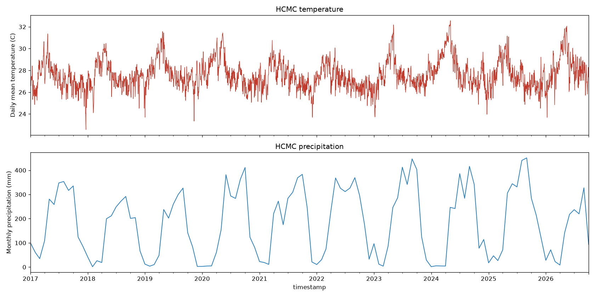
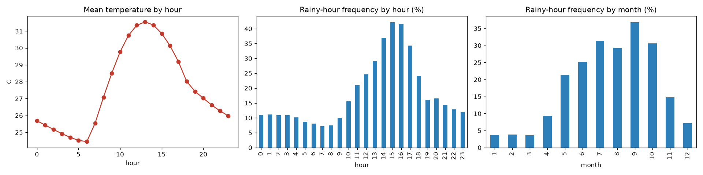
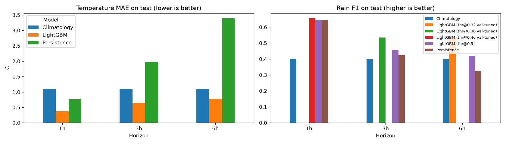
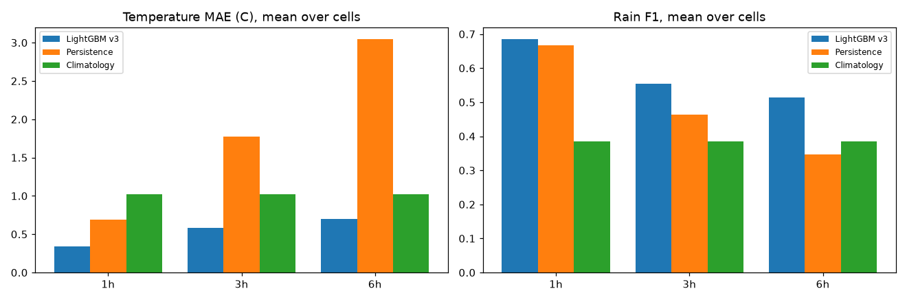
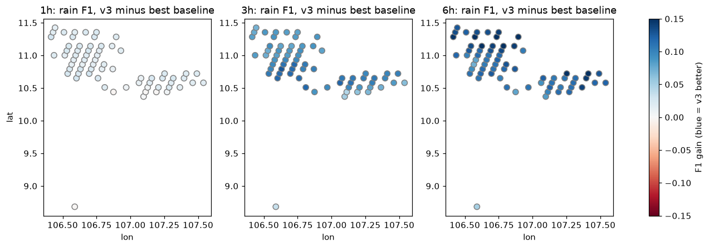
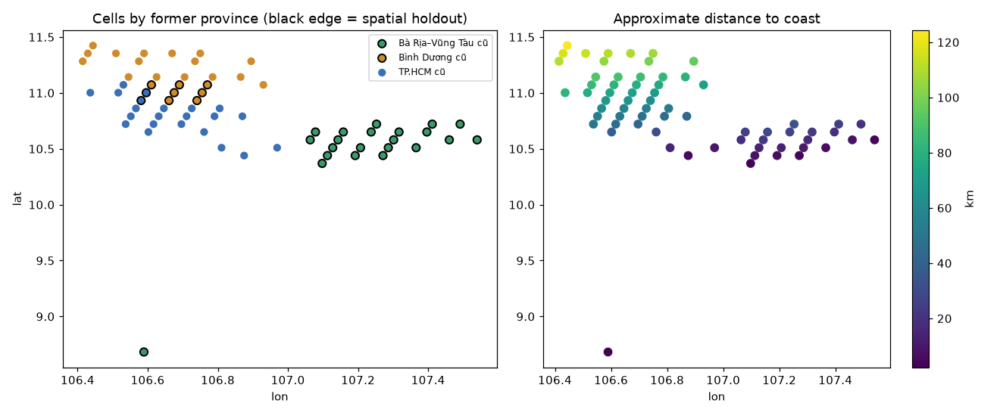
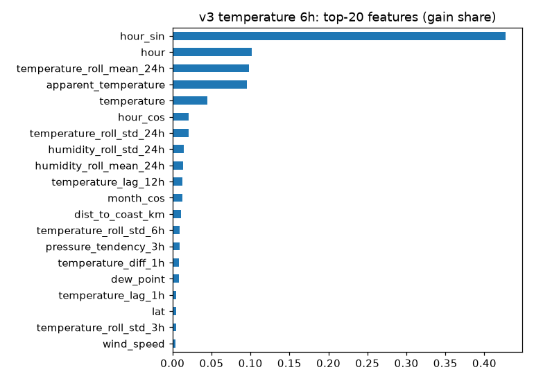

# Báo cáo đồ án: Sky Weather – Ứng dụng thời tiết TP. Hồ Chí Minh có dự báo AI ngắn hạn

## 1. Giới thiệu và mục tiêu

Đề bài (`Chuc nang/1.docx`) mô tả một ứng dụng thời tiết cho TP.HCM gồm 11 nhóm chức năng, từ hiển thị thời tiết, dự báo AI đến thông báo, bản đồ và quản trị mô hình. Nhóm làm theo hai giai đoạn:

- **Giai đoạn 1 (v2, một điểm):** làm trọn một luồng đầu–cuối tại một điểm gần Tân Sơn Nhất: làm sạch dữ liệu, backend FastAPI, mô hình LightGBM dự báo nhiệt độ và khả năng mưa sau 1, 3, 6 giờ, ứng dụng Flutter.
- **Giai đoạn 2 (v3, đa địa điểm):** mở rộng ra toàn bộ **TP.HCM mới** (sau sáp nhập 2025 với Bình Dương và Bà Rịa – Vũng Tàu): 168 phường/xã/đặc khu, dữ liệu cập nhật hằng giờ, một mô hình AI toàn cục cho mọi ô lưới, ứng dụng có chọn địa điểm, so sánh và bản đồ.

Mọi dữ liệu thời tiết trong đồ án là **đầu ra mô hình thời tiết của Open-Meteo, không phải số đo trạm quan trắc**.

## 2. Phân tích yêu cầu

| # | Nhóm chức năng (đề bài) | Trạng thái | Đã làm / ghi chú |
|---|---|---|---|
| 1 | Địa điểm | Đã làm phần chính | 168 phường/xã/đặc khu; chọn bằng GPS, tìm kiếm có/không dấu, lưu địa điểm có nhãn (nhà, nơi làm, trường, yêu thích, tên riêng), sắp xếp, vuốt xoá; so sánh 2–3 nơi. |
| 2 | Thời tiết và dự báo | Đã làm | Thời tiết hiện tại theo từng địa điểm; theo giờ/ngày gồm giờ đã có dữ liệu, dự báo Open-Meteo và (khi thiếu) trung bình nhiều năm, có ghi nguồn; UV, AQI khi Open-Meteo có; nhãn "Dữ liệu cũ"; mặt trời mọc/lặn tính tại máy. |
| 3 | AI dự báo | Làm một phần | Nhiệt độ và xác suất mưa sau 1/3/6 giờ cho mọi ô lưới (mô hình v3); app hiển thị kết quả kiểm chứng tại từng ô. Chưa có khoảng bất định, chưa dự báo lượng mưa/độ ẩm/gió. |
| 4 | Hoạt động và thói quen | Đã làm | 7 hoạt động, chấm điểm từng giờ, gợi ý tối đa 3 khung giờ trong 48 giờ, mức nhạy cảm, lịch lặp lại, nhắc trước 15/30/60/120 phút; học thói quen khi người dùng đồng ý (mục 7.2). |
| 5 | Thông báo linh hoạt | Đã làm | 7 loại cảnh báo chạy trên máy, chỉnh ngưỡng, chống trùng, giờ yên lặng, lịch sử, thông báo hệ thống Android, kiểm tra nền khoảng mỗi giờ (mục 7.1). |
| 6 | Cảnh báo khi di chuyển | Chưa làm | |
| 7 | Bản đồ | Làm phần chính | flutter_map nền OSM, ranh giới, lớp nhiệt độ / mưa / gió (mũi tên hướng gió), đánh dấu cảnh báo, thanh thời gian 0–72 giờ có nút phát, nhãn thực tế/dự báo (mục 7.3). Không có radar thật vì Open-Meteo không cung cấp radar; thay bằng các khung dự báo theo giờ. |
| 8 | Cá nhân hóa | Làm một phần | Sáng/tối, °C/°F, nhãn địa điểm. Chưa có widget. |
| 9 | Tài khoản và quyền riêng tư | Làm một phần | Không cần đăng nhập. Khi dùng GPS, app chỉ lưu **id phường/xã**, không lưu tọa độ. |
| 10 | Độ tin cậy và phản hồi | Làm một phần | Cache offline, trạng thái lỗi và "Thử lại", `/health` báo độ mới của từng ô. Chưa có báo lỗi/góp ý. |
| 11 | Hệ thống AI và quản trị | Làm một phần | Ingest hằng giờ, backfill lịch sử có ngân sách API, huấn luyện và đánh giá theo thời gian và theo không gian, phiên bản mô hình, v2 làm dự phòng. Chưa giám sát chất lượng tự động, chưa huấn luyện lại định kỳ. |

## 3. Dữ liệu

### 3.1 Địa điểm và ô lưới

- Danh sách 168 phường/xã/đặc khu (113 phường, 54 xã, 1 đặc khu) và ranh giới lấy từ **OpenStreetMap** (© OpenStreetMap contributors, ODbL), snapshot Overpass 2026-10-16, quan hệ r1973756. Chi tiết cách làm và các giới hạn: `backend/data/locations/SOURCES.md`, script `backend/scripts/build_locations.py`.
- Theo tỉnh cũ: TP.HCM cũ 102, Bình Dương cũ 36, Bà Rịa – Vũng Tàu cũ 30.
- Mỗi phường có một điểm đại diện (điểm `label` của OSM hoặc điểm nằm trong đa giác). Gửi các điểm này lên Open-Meteo, những phường nhận về cùng tọa độ lưới được gộp chung một **ô lưới** (`om-<lat>-<lon>`). Kết quả: **67 ô lưới** (lưới khoảng 0,07° vĩ × 0,08° kinh, tức khoảng 8 km).
- `tsn` (10.7909°N, 106.6313°E, độ cao cố định 6 m) là điểm huấn luyện của giai đoạn 1, trùng ô lưới `om-10.7909-106.6313` nên được coi là **alias** của ô này. Tổng cộng có 68 chuỗi dữ liệu (67 ô + `tsn`).
- Ranh giới OSM là ranh giới do cộng đồng vẽ, đã đơn giản hóa, không phải ranh giới pháp lý. Danh sách 168 đơn vị khớp tổng số chính thức nhưng chưa được đối chiếu từng đơn vị với văn bản Nghị quyết.

### 3.2 Dữ liệu thời tiết

| Nguồn | Nội dung | Nơi lưu |
|---|---|---|
| File Excel Open-Meteo (giai đoạn 1) | Theo giờ tại `tsn`, 2017-01-01 → 2026-10-10, 85.673 dòng sau làm sạch | `backend/data/weather.db` |
| `backend/ingest.py` (hằng giờ, phút 05) | Giờ mới nhất và dự báo 7 ngày cho 68 chuỗi, chất lượng không khí; chuỗi mới được tải lùi 90 ngày | `weather.db` (`hourly_weather`, `nwp_forecast`, `air_quality`, `ingest_log`) |
| `backend/scripts/backfill_history.py` | Lịch sử theo giờ cho từng ô (Open-Meteo Historical Forecast API), 12 biến dùng làm đặc trưng | File riêng `backend/data/history/cells_history.db` |

Script backfill tính "trọng số" mỗi lần gọi theo quy tắc của Open-Meteo và giữ dưới ngân sách cuộn (mặc định 500/phút, 4500/giờ, 9000/ngày), tự nghỉ khi hết, lùi lại khi gặp HTTP 429. Mọi lần gọi được ghi vào bảng `request_log`, nên khi bị ngắt có thể chạy tiếp mà không tải lại. Ô `tsn` được sao chép từ `weather.db` thay vì tải lại. Thứ tự ưu tiên: 2023 → hôm qua cho mọi ô, sau đó lùi từng năm về 2017.

Độ phủ hiện tại (`python scripts/backfill_history.py --status`, ngày 2026-10-17):

| Năm | Số ô có dữ liệu |
|---|---|
| 2017–2021 | 1 (ô alias của `tsn`) |
| 2022 | 31 |
| 2023 – 2026-10-16 | 67 |

Không có giá trị rỗng trong các cột đã tải. Backfill vẫn đang chạy.

Khi cần trung bình nhiều năm (ví dụ ngày ngoài tầm dự báo), backend dùng khí hậu riêng của ô nếu ô có đủ dữ liệu, không thì dùng của `tsn` (chi tiết ở mục 7.4).

### 3.3 Làm sạch dữ liệu giai đoạn 1 (`backend/convert_excel_to_sqlite.py`)

1. Tự tìm dòng tiêu đề có cột `time`, đổi tên cột sang tên ngắn, giữ 16 cột cần dùng.
2. Loại khối dữ liệu theo ngày nằm nối tiếp bên dưới khối theo giờ.
3. Chuyển số; giá trị lỗi thành rỗng. Các dòng trước 2017-01-01 toàn lỗi `#NUM!` nên bị bỏ.
4. Ghi vào bảng `hourly_weather`. File Excel gốc không bị sửa.

| Chỉ tiêu | Giá trị |
|---|---|
| Số dòng | 85.673 |
| Khoảng thời gian | 2017-01-01 07:00 → 2026-10-10 23:00 |
| Trùng thời điểm / khoảng cách khác 1 giờ | 0 / 0 |
| Thiếu dữ liệu | `precipitation_probability` 74,91%, `visibility` 43,20%; các cột khác đầy đủ |

### 3.4 Khám phá dữ liệu tại `tsn`

| Biến | Trung bình | Nhỏ nhất | Lớn nhất |
|---|---|---|---|
| Nhiệt độ (°C) | 27,6 | 17,9 | 39,4 |
| Độ ẩm (%) | 78,0 | 21 | 100 |
| Lượng mưa (mm/giờ) | 0,25 | 0 | 22,3 |
| Áp suất mực biển (hPa) | 1009,5 | 1000,2 | 1019,1 |
| Tốc độ gió (km/h) | 8,4 | 0 | 39,9 |



*Hình 1. Nhiệt độ trung bình ngày và tổng lượng mưa tháng tại `tsn`, 2017–2026.*



*Hình 2. Nhiệt độ trung bình theo giờ; tần suất giờ có mưa theo giờ và theo tháng.*

- Nhiệt độ thấp nhất khoảng 6 giờ sáng (~24,5°C), cao nhất khoảng 13 giờ (~31,5°C).
- Mưa tập trung buổi chiều, cao nhất khoảng 15–16 giờ (trên 40% số giờ). Mùa mưa từ tháng 5 đến 11; tháng 9 có tỷ lệ giờ mưa cao nhất (36,8%), tháng 1–3 khoảng 4%.
- **18,2% số giờ có mưa** (khoảng 82% số giờ khô): dữ liệu mất cân bằng, ảnh hưởng tới cách đọc Accuracy.

Trên toàn bộ 67 ô (dữ liệu huấn luyện v3), nhiệt độ nằm trong 15,4–39,4°C, lượng mưa lớn nhất 29,3 mm/giờ, không có dòng trùng (ô, thời điểm).

## 4. Kiến trúc hệ thống

```
Flutter app  <--HTTP/JSON-->  FastAPI backend  -->  SQLite weather.db (68 chuỗi, dự báo NWP, AQI, phường/xã, ô lưới)
 Provider, cache,              routers/weather.py     ai_model.py --> LightGBM v3 (models/v3/), v2 dự phòng
 flutter_map (OSM)             routers/locations.py   ingest.py (mỗi giờ) <-- Open-Meteo
```

| Thành phần | Công nghệ | Vai trò |
|---|---|---|
| Ứng dụng | Flutter, `provider`, `http`, `fl_chart`, `shared_preferences`, `geolocator`, `flutter_map` | Gọi API, hiển thị, GPS, bản đồ, lưu cài đặt và cache |
| Backend | FastAPI, pandas, SQLite | Phục vụ dữ liệu, địa điểm, kết quả AI; lịch ingest hằng giờ |
| AI | LightGBM, joblib | 3 mô hình hồi quy nhiệt độ + 3 mô hình phân loại mưa (v3) |
| Huấn luyện | `scripts/train_global_v3.py`, Jupyter | Huấn luyện, đánh giá theo ô, spatial holdout, kiểm tra rò rỉ |

### 4.1 Endpoint

Mọi `/weather/*` (trừ `/weather/map` và `/weather/map/meta`) nhận `location_id`: id phường/xã, một `cell_id` hoặc `tsn` (mặc định). Backend đổi `location_id` → ô lưới → chuỗi dữ liệu; id không tồn tại trả 404. Hầu hết endpoint nhận thêm `at` để xem lại một thời điểm trong quá khứ (không cho phép dữ liệu sau `at` lọt vào).

| Endpoint | Nội dung |
|---|---|
| `GET /health` | Trạng thái API, DB, lần ingest gần nhất; `cells`: tổng số ô, số ô có dữ liệu trong 3 giờ qua, danh sách ô cũ |
| `GET /locations` | 168 phường/xã/đặc khu + `tsn`: id, tên, loại, tỉnh cũ, tọa độ, `cell_id` |
| `GET /locations/search?q=` | Tìm theo tên không phân biệt dấu; xếp hạng: khớp hẳn, tiền tố, tiền tố của từ, chuỗi con; tối đa 20 |
| `GET /locations/nearest?lat=&lon=` | Phường chứa điểm (`method: polygon`), nếu rơi vào khe giữa các đa giác thì phường gần nhất (`nearest`); ngoài ranh giới TP.HCM trả **404 "Ngoài vùng hỗ trợ (TP.HCM)"** |
| `GET /locations/boundary`, `/locations/wards` | GeoJSON ranh giới thành phố và từng phường (© OSM, ODbL), có ETag và cache 1 ngày |
| `GET /locations/current` | Cũ: điểm cố định gần Tân Sơn Nhất |
| `GET /weather/current` | Giờ mới nhất của chuỗi, kèm chất lượng không khí trong ±1 giờ nếu có |
| `GET /weather/hourly` | 1–168 giờ: giờ đã có dữ liệu → dự báo Open-Meteo mới nhất → trung bình nhiều năm; trường `source` = `observed` / `forecast` / `climatology` |
| `GET /weather/daily` | 1–14 ngày, tổng hợp từ chuỗi theo giờ như trên |
| `GET /weather/history` | Dữ liệu theo giờ trong khoảng ngày, tối đa 365 ngày |
| `GET /weather/ai-forecast` | Nhiệt độ và xác suất mưa sau 1/3/6 giờ từ 48 giờ dữ liệu cuối; `model_version`, `cell_id`, `evaluation` |
| `GET /weather/ai-verify` | Dự báo AI phát hành tại `at` (mặc định 6 giờ trước) đặt cạnh giá trị thực tế của chuỗi |
| `GET /weather/map` | Mỗi ô tại khung *t* = hiện tại + `offset_hours` (0–72): nhiệt độ, mã thời tiết, gió (`wind_speed`, `wind_direction`, `wind_gusts`), lượng mưa, tổng mưa và xác suất mưa 3 giờ sau *t*, `alert` (mã dông hoặc ≥ 10 mm trong 3 giờ; theo mô hình, không chính thức), `source`, `valid_time`, `outlook_source` (mục 7.3) |
| `GET /weather/map/meta` | `now`, `max_offset_hours` (tối đa 72; bằng 0 ở chế độ xem lại), `issued_at` của lần dự báo NWP mới nhất |
| `POST /admin/ingest` | Ingest thủ công; chỉ từ localhost, hoặc cần `X-Admin-Token` nếu đặt `ADMIN_TOKEN` |

Hàm tạo đặc trưng trong `backend/ai_model.py` được **dùng chung** cho huấn luyện và suy luận. Khi nạp mô hình, backend kiểm tra danh sách đặc trưng đã lưu khớp với code; nếu file v3 thiếu hoặc không khớp, backend tự dùng v2.

## 5. Mô hình AI

### 5.1 Bài toán

Dự báo chuỗi thời gian kiểu tự giám sát: tại thời điểm phát hành *t*, đặc trưng chỉ lấy từ dữ liệu đến *t*; nhãn là giá trị của chính chuỗi dữ liệu tại *t+1*, *t+3*, *t+6* giờ.

- **Nhiệt độ**: hồi quy LightGBM, đánh giá bằng MAE (°C).
- **Mưa**: phân loại LightGBM, nhãn = lượng mưa trong giờ *t+h* ≥ 0,1 mm. Đánh giá bằng F1, Accuracy, Brier.

### 5.2 Mô hình cơ sở

- **Persistence**: giá trị sau *h* giờ = giá trị hiện tại.
- **Climatology**: trung bình của tập train theo (tháng, giờ) của thời điểm đích, tính **riêng từng ô**; dự báo mưa khi tần suất > 0,5.

### 5.3 Mô hình v2 (một điểm `tsn`)

Phiên bản `lgbm-hcmc-v2-20261015`, notebook `notebooks/weather_forecasting.ipynb`, file trong `backend/models/`. Hiện là **dự phòng** khi không nạp được v3.

- 72 đặc trưng: giá trị tại *t* (nhiệt độ, độ ẩm, điểm sương, nhiệt độ cảm nhận, lượng mưa, mã thời tiết, mây, áp suất, gió, hướng gió sin/cos); trễ *t−1, 3, 6, 12, 24 giờ*; trung bình và độ lệch chuẩn trượt 3/6/24 giờ về quá khứ; giờ, thứ, tháng, mùa mưa, sin/cos; thay đổi nhiệt độ 1 giờ, xu hướng áp suất 3 giờ, số giờ mưa trong 24 giờ qua. Không dùng `precipitation_probability`, `visibility`, `rain`.
- Chia theo thời gian: train 2017–2023, validation 2024, test 2025-01-01 → 2026-10-10; bỏ 6 giờ cuối mỗi tập.
- Tham số cố định (learning_rate 0,05, num_leaves 31, early stopping trên validation); ngưỡng mưa 0,46 / 0,36 / 0,32.

Kết quả test tại `tsn`:

| Tầm | MAE nhiệt độ: Persistence / Climatology / v2 | F1 mưa: Persistence / Climatology / v2 |
|---|---|---|
| 1 giờ | 0,758 / 1,103 / **0,372** | 0,645 / 0,399 / **0,655** |
| 3 giờ | 1,972 / 1,103 / **0,644** | 0,424 / 0,399 / **0,535** |
| 6 giờ | 3,392 / 1,102 / **0,770** | 0,324 / 0,399 / **0,528** |

Mưa 1 giờ của v2 gần như ngang persistence. Ở 3–6 giờ, Accuracy của v2 (0,829 / 0,821) thấp hơn climatology (0,835) một chút vì climatology gần như luôn đoán "không mưa"; F1 và Brier (0,109 / 0,112 so với 0,120) cho thấy v2 tốt hơn.



*Hình 3. MAE nhiệt độ và F1 mưa của v2 tại `tsn`.*

### 5.4 Mô hình v3 toàn cục (đang phục vụ)

Phiên bản `lgbm-hcmc-global-v3-20261017`. Code: `backend/scripts/train_global_v3.py`; notebook: `notebooks/global_model.ipynb`; file: `backend/models/v3/` (`metadata_v3.json`, `evaluation_v3.json`, `per_cell_metrics.csv`, `cell_static.json`).

Một mô hình duy nhất cho mọi ô, huấn luyện trên `cells_history.db` (2.278.046 dòng có đủ đặc trưng, 67 ô).

**Đặc trưng (79 cột)** = 72 đặc trưng của v2 + 7 đặc trưng tĩnh của ô:

| Đặc trưng tĩnh | Cách lấy |
|---|---|
| `lat`, `lon`, `elevation` | Tọa độ lưới và độ cao dùng khi tải dữ liệu |
| `dist_to_coast_km` | Khoảng cách tới đường bờ biển **số hóa bằng tay** (Cần Giờ – Vũng Tàu – Bình Châu, cộng một vòng quanh Côn Đảo), sai số cỡ vài km |
| `region_hcm`, `region_bd`, `region_brvt` | Tỉnh cũ chiếm đa số trong các phường của ô (one-hot) |

**Chia dữ liệu theo thời gian** (theo thời điểm phát hành *t*; một dòng chỉ thuộc một tập nếu cả *t* và *t+6h* nằm trong tập đó; **đệm 7 ngày** giữa các tập):

| Tập | Khoảng thời gian | Số dòng | Mục đích |
|---|---|---|---|
| Train | đến 30/06/2024 (66 ô từ 01/2023; ô `tsn` từ 2017) | 930.143 | Huấn luyện |
| Validation | 08/07/2024 – 24/12/2024 | 272.958 | Early stopping, chọn ngưỡng mưa |
| Test | từ 01/01/2025 (đến 16/10/2026) | 1.051.629 | Đánh giá, cả 67 ô |

Lý do: 2023–2025 là khoảng duy nhất mọi ô đều có dữ liệu lúc huấn luyện; test trọn năm 2025 bao cả mùa khô và mùa mưa. Mô hình được huấn luyện trước khi backfill thêm năm 2022, nên với 66 ô, train chỉ có khoảng 18 tháng.

**Cấu hình:** learning_rate 0,05, num_leaves 63, feature_fraction 0,8, bagging_fraction 0,8, min_data_in_leaf 100, tối đa 3000 vòng, early stopping 100 vòng trên validation, seed 42. Một ngưỡng mưa cho mọi ô, chọn trên validation: 0,39 / 0,33 / 0,32. Không tìm kiếm siêu tham số.

### 5.5 Kết quả v3 trên tập test (trung bình trên 67 ô, mỗi ô trọng số như nhau)

| Tầm | MAE nhiệt độ (°C): Persistence / Climatology / **v3** | F1 mưa: Persistence / Climatology / **v3** | Brier v3 |
|---|---|---|---|
| 1 giờ | 0,691 / 1,024 / **0,344** | 0,668 / 0,384 / **0,685** | 0,084 |
| 3 giờ | 1,774 / 1,024 / **0,579** | 0,464 / 0,384 / **0,555** | 0,114 |
| 6 giờ | 3,046 / 1,024 / **0,699** | 0,347 / 0,384 / **0,513** | 0,121 |

Số ô mà v3 tốt hơn **cả hai** mô hình cơ sở:

| Tầm | Theo MAE | Theo F1 |
|---|---|---|
| 1 giờ | 66/67 | 63/67 |
| 3 giờ | 66/67 | 67/67 |
| 6 giờ | 67/67 | 67/67 |

Tính cả MAE và F1 ở cả 3 tầm, v3 thắng ở **63/67 ô**. Bốn ô còn lại:

- 3 ô (1 ô thuộc TP.HCM cũ, 2 ô thuộc Bà Rịa – Vũng Tàu cũ) chỉ thua persistence về F1 mưa 1 giờ, chênh 0,001–0,002.
- **Côn Đảo** (`om-8.6819-106.5892`): thua persistence về MAE ở 1 giờ (0,242 so với 0,203) và 3 giờ (0,390 so với 0,380), và F1 mưa 1 giờ (0,664 so với 0,666). Ở đảo xa bờ, nhiệt độ biến đổi rất ít trong ngày nên persistence đã rất mạnh.



*Hình 4. MAE nhiệt độ và F1 mưa trung bình trên 67 ô.*



*Hình 5. F1 mưa của v3 trừ mô hình cơ sở tốt nhất, theo vị trí ô (xanh = v3 tốt hơn).*

### 5.6 Spatial holdout (kiểm tra tổng quát sang vùng chưa thấy)

Huấn luyện một mô hình thứ hai **không có** 31 ô: toàn bộ ô thuộc Bà Rịa – Vũng Tàu cũ (22 ô, gồm Côn Đảo) và ô Thủ Dầu Một cùng các ô lân cận trong 1,5 bước lưới (7 ô Bình Dương cũ, 2 ô TP.HCM cũ). Sau đó đánh giá trên chính 31 ô này trong cùng thời gian test. Climatology vẫn tính từ lịch sử riêng của từng ô.



*Hình 6. Các ô theo tỉnh cũ (viền đen = ô bị giữ lại cho holdout) và khoảng cách tới biển ước lượng.*

Trung bình trên 31 ô:

| Tầm | MAE: holdout / mô hình đầy đủ / Persistence / Climatology | F1: holdout / mô hình đầy đủ / Persistence / Climatology |
|---|---|---|
| 1 giờ | 0,355 / 0,335 / 0,660 / 0,969 | 0,666 / 0,679 / 0,664 / 0,374 |
| 3 giờ | 0,615 / 0,562 / 1,674 / 0,969 | 0,537 / 0,549 / 0,462 / 0,374 |
| 6 giờ | 0,751 / 0,675 / 2,860 / 0,969 | 0,489 / 0,505 / 0,342 / 0,374 |

- Mô hình holdout vẫn tốt hơn cả hai mô hình cơ sở ở mọi chỉ số tại **23/31 ô**. Sai số chỉ tăng nhẹ so với mô hình đã thấy các ô này, nên với vùng đất liền mô hình tổng quát khá tốt.
- **Côn Đảo là ngoại lệ rõ:** khi bị giữ lại, MAE nhiệt độ 6 giờ là **1,56°C so với 0,52°C của persistence**, F1 mưa 6 giờ 0,256 so với 0,448. Không còn ô đảo xa bờ nào khác trong dữ liệu huấn luyện, nên mô hình **không tổng quát tốt sang một đảo chưa thấy**.

Mô hình đang phục vụ là mô hình đầy đủ (đã thấy cả 67 ô). App hiển thị kết quả kiểm chứng của từng ô qua trường `evaluation` của `/weather/ai-forecast`: nếu ô đạt mô hình cơ sở thì hiện "Sai số kiểm chứng tại ô lưới này: ±…", nếu không (như Côn Đảo) thì hiện "Tại ô lưới này, AI chưa vượt mô hình cơ sở".

### 5.7 So sánh v2 và v3 tại `tsn`

Cùng các giờ phát hành trong test (từ 01/01/2025), mỗi mô hình dùng ngưỡng mưa riêng chọn trên validation của nó:

| Tầm | MAE v2 | MAE v3 | F1 v2 | F1 v3 |
|---|---|---|---|---|
| 1 giờ | 0,379 | **0,360** | 0,653 | **0,670** |
| 3 giờ | 0,647 | **0,623** | 0,535 | **0,552** |
| 6 giờ | 0,791 | **0,753** | **0,525** | 0,514 |

v3 tốt hơn v2 ở nhiệt độ mọi tầm và mưa 1–3 giờ, kém hơn một chút ở mưa 6 giờ. Hai mô hình có tập train/validation khác nhau (v2: train 2017–2023, validation 2024; v3: train đến 06/2024) nhưng đều chưa thấy dữ liệu từ 2025.

### 5.8 Độ quan trọng đặc trưng



*Hình 7. 20 đặc trưng quan trọng nhất của mô hình nhiệt độ 6 giờ (v3).*

Đặc trưng tĩnh chỉ chiếm phần nhỏ trong gain của mô hình nhiệt độ 6 giờ: `dist_to_coast_km` 1,06%, `lat` 0,47%, `lon` 0,13%, `elevation` 0,10%, các biến vùng gần 0. Mô hình chủ yếu dựa vào chính chuỗi thời tiết gần đây của ô.

### 5.9 Kiểm tra rò rỉ dữ liệu

| Kiểm tra | Cách làm | Kết quả |
|---|---|---|
| Nhiễu tương lai | Thay mọi giá trị sau *t* bằng số ngẫu nhiên, tính lại đặc trưng tại *t* (v3: 60 thời điểm ở 3 ô) | 0/60 bị thay đổi (v2: 0/6) |
| Rà soát cột | Không có cột nhãn, `precipitation_probability`, `visibility`, `rain` | Danh sách vi phạm rỗng |
| Ranh giới tập | *t* và *t+6h* cùng một tập, đệm 7 ngày giữa các tập | Đạt (kiểm tra trong script và notebook) |
| Chọn ngưỡng | Early stopping và ngưỡng mưa chỉ dùng validation | Test chỉ dùng để báo cáo |
| Nhất quán huấn luyện – chạy thật | Gọi `predict_for_location` trên 15 cửa sổ 48 giờ lấy từ DB, so với dự đoán lúc huấn luyện | Chênh lệch lớn nhất 0,0047, do làm tròn |

### 5.10 Quản lý phiên bản

Mỗi kết quả AI trả `model_version`; app hiển thị nó. `metadata_v3.json` ghi snapshot dữ liệu đã dùng của từng ô, mốc chia, tham số, ngưỡng và kết quả holdout. Nếu file v3 lỗi, backend tự phục vụ v2 và trả đánh giá của v2.

## 6. Ứng dụng

### 6.1 Địa điểm

- **GPS:** app lấy vị trí, gọi `/locations/nearest` và chỉ lưu **id phường/xã** (`gps_location_id`), không lưu tọa độ. Ngoài TP.HCM, app hiện thông báo "Ngoài vùng hỗ trợ". Xử lý các trường hợp tắt định vị, từ chối quyền (có nút mở cài đặt).
- **Tìm kiếm:** lọc tại máy, không phân biệt dấu, kết hợp `/locations/search`.
- **Địa điểm đã lưu:** gán nhãn (nhà, nơi làm, trường, yêu thích, tên riêng), kéo để sắp xếp, vuốt để xoá (có "Hoàn tác").
- **So sánh:** chọn 2–3 địa điểm để xem cạnh nhau (`compare_screen.dart`).

### 6.2 Trang chủ

- Mỗi địa điểm (vị trí hiện tại + các nơi đã lưu) là một trang của **PageView**, vuốt ngang để chuyển.
- Thời tiết hiện tại, chi tiết (độ ẩm, gió, áp suất, mây…), nguồn và thời điểm cập nhật, nhãn "Dữ liệu cũ" khi cần.
- Thẻ **"Dự báo AI (thử nghiệm)"**: nhiệt độ và khả năng mưa sau 1/3/6 giờ, phiên bản mô hình và dòng đánh giá tại ô lưới (mục 5.6).
- Theo giờ và theo ngày, có huy hiệu nguồn (đã ghi nhận / dự báo / trung bình nhiều năm).

### 6.3 Bản đồ

- `flutter_map` với nền tile OpenStreetMap, có dòng ghi công "© OpenStreetMap contributors".
- Ranh giới TP.HCM mới; mỗi ô lưới một điểm đánh dấu; địa điểm đã lưu là ghim.
- Hai lớp: **Nhiệt độ** và **Khả năng mưa 3h**, có chú giải màu.
- Ô có `alert` (mã dông hoặc ≥ 10 mm trong 3 giờ tới) được đánh dấu "có cảnh báo mưa dông". Đây là ngưỡng theo dữ liệu mô hình, không phải cảnh báo chính thức.
- Khung dự báo theo giờ, lớp gió và thanh thời gian: xem mục 7.3.

### 6.4 Cài đặt, lỗi và offline

- Sáng/tối, °C/°F, thông tin nguồn dữ liệu, lưu ý dự báo AI chỉ để tham khảo, cảnh báo chính thức xem tại Đài KTTV khu vực Nam Bộ.
- Lưu dữ liệu lần tải thành công gần nhất; mất mạng thì hiện dữ liệu đã lưu kèm thông báo; không có cache thì hiện lỗi và nút "Thử lại".

Ảnh chụp giao diện (bản web, khung 390×844, dữ liệu thật từ backend):

| Trang chủ | Xem lại 07/10/2026 | Kiểm chứng AI |
|---|---|---|
|  |  |  |

| Bản đồ – nhiệt độ | Bản đồ – gió (phóng to) | Thanh thời gian +18 giờ |
|---|---|---|
|  |  |  |

Ảnh bản đồ chụp khi trình duyệt không tải được nền OpenStreetMap nên nền tối; mỗi ô màu là một ô lưới khoảng 8 km.

## 7. Cảnh báo, hoạt động, bản đồ theo giờ và khí hậu theo ô

### 7.1 Cảnh báo chạy trên máy (nhóm 5)

Code: `lib/models/weather_alerts.dart` (luật, thuần Dart, không gọi mạng), `lib/screens/alerts_screen.dart`, `lib/screens/alert_settings_screen.dart`. App lấy dữ liệu theo giờ của địa điểm (giờ đã ghi nhận và dự báo; bỏ qua giờ chỉ có trung bình nhiều năm), xét **24 giờ tới** (chỉnh được 1–48), gộp các giờ liên tiếp cùng loại thành một cảnh báo. Ba mức: **Lưu ý < Cảnh báo < Nguy hiểm**.

| Loại | Ngưỡng mặc định (chỉnh được) | Mức độ |
|---|---|---|
| Mưa | Xác suất mưa ≥ 70% | Lưu ý; ≥ 90% → Cảnh báo. Giờ đã ghi nhận: lượng mưa ≥ 0,5 mm → Lưu ý |
| Mưa lớn | ≥ 10 mm/giờ | Cảnh báo; ≥ 2 lần ngưỡng (20 mm) → Nguy hiểm |
| Dông | Mã thời tiết 95–99 (không chỉnh) | Cảnh báo; mã 96, 99 (dông kèm mưa đá) → Nguy hiểm |
| Nắng nóng | Nhiệt độ ≥ 35 °C, hoặc nhiệt độ cảm giác ≥ 41 °C | Nhiệt độ: Cảnh báo, ≥ 39 °C → Nguy hiểm. Cảm giác: Lưu ý, ≥ 46 °C → Cảnh báo, ≥ 54 °C → Nguy hiểm. Lấy mức cao hơn |
| UV cao | UV ≥ 8 | 8 đến dưới 11 → Cảnh báo; ≥ 11 → Nguy hiểm |
| Gió giật mạnh | Gió giật ≥ 50 km/h | Cảnh báo; ≥ ngưỡng + 25 (75 km/h) → Nguy hiểm |
| Không khí kém | US AQI ≥ 151 | 151–200 → Cảnh báo; ≥ 201 → Nguy hiểm |

Nhiệt độ cảm giác lấy `apparent_temperature`; nếu thiếu thì tính chỉ số nhiệt (công thức NOAA/Rothfusz) từ nhiệt độ và độ ẩm. Nếu người dùng hạ ngưỡng UV hoặc AQI, giá trị dưới 8 (UV) hoặc dưới 151 (AQI) được xếp mức Lưu ý.

**Chống trùng và mức ưu tiên** (`planNotices`):

- Chỉ tạo thông báo từ mức tối thiểu, mặc định **Cảnh báo** (người dùng chỉnh được).
- Đã có thông báo cùng loại, cùng địa điểm và khung giờ giao nhau thì **không gửi lại**. Chỉ gửi tiếp khi mức độ **tăng**, với tiêu đề bắt đầu bằng "Cập nhật:".
- Khoá chống trùng là loại + địa điểm + giờ bắt đầu. Bản lưu của app đang mở và của tác vụ nền được gộp theo khoá này, giữ mức cao nhất.

**Giờ yên lặng:** mặc định 22:00–06:00 (giờ TP.HCM), bật/tắt và chỉnh được. Trong giờ yên lặng chỉ mức **Nguy hiểm** được gửi; các cảnh báo khác bị giữ lại và được đếm.

**Lịch sử:** lưu tối đa 50 thông báo trên máy, màn Cảnh báo hiện 20 mục mới nhất và có nút xoá; trang chủ hiện số thông báo chưa đọc. Nội dung ghi rõ "Đang xảy ra (số liệu phân tích)" hay "Dự báo".

**Thông báo hệ thống Android** (`lib/services/notification_service.dart`, `flutter_local_notifications`): kênh "Cảnh báo thời tiết" (mức quan trọng cao) và kênh "Nhắc hoạt động". App **chỉ xin quyền thông báo (Android 13+) khi người dùng bật công tắc**; nếu bị từ chối thì công tắc giữ ở trạng thái tắt. Trên web và desktop, dịch vụ này không làm gì. Thông báo luôn hiện trong app (lịch sử ở màn Cảnh báo), kể cả khi thông báo hệ thống tắt.

**Kiểm tra khi app ở nền** (`lib/services/background_check.dart`): khi bật thông báo hệ thống, app đăng ký một tác vụ `workmanager` định kỳ **khoảng mỗi giờ**, chỉ chạy khi có mạng (hệ điều hành có thể giãn khoảng này). Mỗi lần chạy, tác vụ tải dữ liệu của vị trí hiện tại và các địa điểm đã lưu, chạy luật cảnh báo, gửi thông báo theo quy tắc chống trùng và giờ yên lặng ở trên, rồi hẹn lại nhắc hoạt động.

**Chế độ xem lại** (`at`): cảnh báo được tính theo thời điểm xem lại nhưng **không gửi thông báo và không ghi vào lịch sử**; tác vụ nền cũng bỏ qua khi app đang ở chế độ này.

App luôn hiện dòng miễn trừ: "Cảnh báo dựa trên dữ liệu mô hình, không phải cảnh báo chính thức – xem Đài KTTV khu vực Nam Bộ".

### 7.2 Hoạt động và thói quen (nhóm 4)

Code: `lib/models/activities.dart`, `reminders.dart`, `habits.dart`, `lib/providers/planner_provider.dart`.

**7 hoạt động**, mỗi hoạt động có hồ sơ riêng:

| Hoạt động | Nhiệt độ cảm giác dễ chịu (°C) | UV tối đa | Gió giật tối đa (km/h) | Khung giờ được gợi ý | Độ dài khung |
|---|---|---|---|---|---|
| Chạy bộ | 20–30 | 5 | 35 | 5–9 giờ, 16–20 giờ | 1 giờ |
| Đạp xe | 20–31 | 5 | 30 | 5–9 giờ, 16–19 giờ | 2 giờ |
| Đi làm / đi học | 20–34 | 8 | 45 | 6–9 giờ, 16–19 giờ | 1 giờ |
| Giặt phơi đồ | 24–40 | 12 | 50 | 7–14 giờ | 3 giờ |
| Đi chơi | 22–32 | 6 | 40 | 7–10 giờ, 15–21 giờ | 3 giờ |
| Chụp ảnh | 20–34 | 9 | 40 | 5–8 giờ, 15–17 giờ | 1 giờ |
| Tưới cây | 18–34 | 4 | 40 | 5–8 giờ, 16–18 giờ | 1 giờ |

**Chấm điểm từng giờ** (`scoreHour`, 0–100): bắt đầu từ 100 rồi trừ điểm:

- nóng hơn khoảng dễ chịu: 6 điểm/°C; lạnh hơn: 5 điểm/°C;
- mưa: xác suất mưa × trọng số mưa của hoạt động (50–100; giặt phơi đồ là 100); giờ đã ghi nhận có ≥ 0,5 mm được tính như xác suất 0,9;
- dông (mã 95–99): 60 điểm;
- UV vượt mức tối đa: 8 điểm mỗi đơn vị; gió giật vượt mức: 1,5 điểm mỗi km/h;
- AQI trên 50: 0,4 điểm mỗi đơn vị × hệ số AQI của hoạt động (0 với giặt phơi đồ và tưới cây).

Giặt phơi đồ bị trừ 15 điểm khi UV < 2 (ít nắng); chụp ảnh được cộng 10 điểm vào giờ "vàng" (5, 6, 16, 17 giờ). Giờ nằm ngoài khung giờ của hoạt động được 0 điểm. Giá trị thiếu không bị trừ.

**Gợi ý khung giờ** (`bestWindows`): trong **48 giờ** tới, tìm các khung gồm các giờ liên tiếp có dữ liệu và nằm trong khung giờ của hoạt động. Điểm khung = 70% điểm trung bình + 30% điểm giờ tệ nhất. App trả **tối đa 3 khung không chồng nhau**, điểm cao trước, kèm xếp hạng (Tốt ≥ 75, Khá ≥ 55, còn lại Kém) và lý do ngắn (ví dụ xác suất mưa, khoảng nhiệt độ cảm giác, yếu tố bị trừ nhiều nhất).

**Mức nhạy cảm:** Ít / Vừa / Nhiều, nhân mọi điểm trừ thời tiết với 0,7 / 1,0 / 1,4.

**Lịch lặp lại và nhắc** (`ActivityRoutine`, `planReminders`):

- Mỗi lịch gồm hoạt động, địa điểm, giờ:phút, các ngày trong tuần và mức nhạy cảm.
- Nhắc trước **15 / 30 / 60 / 120 phút** (mặc định 30). App hẹn các lần diễn ra trong 48 giờ tới, tối đa 40 thông báo.
- Nội dung nhắc gồm điểm thời tiết của giờ đó (nếu đã có dự báo). Nếu giờ đã chọn xấu, app gợi ý một giờ khác trong phạm vi ±3 giờ, với điều kiện giờ đó đạt ≥ 55 điểm và hơn giờ đã chọn ít nhất 15 điểm.
- Nhắc được hẹn bằng `zonedSchedule` theo múi **Asia/Ho_Chi_Minh**, chế độ `inexactAllowWhileIdle` (không cần quyền báo thức chính xác) nên **có thể lệch vài phút**.
- Mặc định nhắc vẫn gửi trong giờ yên lặng vì người dùng tự đặt; có tuỳ chọn bỏ qua giờ yên lặng.

**Học thói quen (đề bài mục 4.4):**

- **Mặc định tắt**; chỉ ghi khi người dùng bật (đồng ý).
- Chỉ đếm số lần theo giờ trong ngày (0–23): lần mở app và lần bấm "Đã làm" một hoạt động. Không ghi vị trí, **chỉ lưu trên máy**, không gửi lên server.
- Giờ có ≥ 2 lần "Đã làm" là "giờ quen": khung gợi ý trùng giờ này được cộng 8 điểm và ghi rõ "Hợp giờ quen". Giờ hay mở app (≥ 3 lần) được cộng 3 điểm.
- Từ 3 lần "Đã làm" cùng giờ, app gợi ý tạo lịch; người dùng có thể xác nhận hoặc bỏ qua.
- Tắt thì app ngừng ghi; nút **Xoá** đưa dữ liệu về 0.

### 7.3 Bản đồ theo giờ (nhóm 7)

Backend (`backend/routers/weather.py`):

- `GET /weather/map?offset_hours=0..72` trả **mỗi chuỗi dữ liệu một mục: 67 ô** (ô alias `tsn` được gộp vào ô lưới trùng với nó). Mỗi mục có nhiệt độ, mã thời tiết, **gió** (`wind_speed`, `wind_direction`, `wind_gusts`), lượng mưa, tổng mưa và xác suất mưa 3 giờ sau khung, `alert`, cùng `source` và `valid_time` (thời điểm của khung).
- `offset_hours = 0`: giờ đã ghi nhận mới nhất (`source = "observed"`). `offset_hours > 0`: lấy giờ *t* từ lần dự báo Open-Meteo mới nhất (`source = "forecast"`).
- `GET /weather/map/meta` trả `now`, `max_offset_hours` (số giờ tới giờ cuối của lần dự báo mới nhất, tối đa 72) và `issued_at`.
- **Chế độ xem lại** chỉ cho `offset_hours = 0`; giá trị khác trả **400**, vì khung tương lai cần dữ liệu phát hành sau `at`. Ở chế độ này, phần mưa 3 giờ tới lấy từ **dự báo AI v3 phát hành đúng tại `at`** (`outlook_source = "ai"`), chỉ dùng dữ liệu đến `at`, nên bản đồ không lộ dữ liệu sau `at`.
- **Không có radar:** Open-Meteo không cung cấp radar. Thay vào đó, bản đồ dùng các khung dự báo theo giờ.

App: lớp nhiệt độ, lớp khả năng mưa 3 giờ và đánh dấu cảnh báo đã có (mục 6.3). **Lớp gió**: mũi tên chỉ hướng gió thổi tới, màu theo tốc độ, đánh dấu gió giật ≥ 50 km/h. **Thanh thời gian** chọn khung 0–72 giờ, có nút phát/dừng (tắt khi bật giảm chuyển động); ở chế độ xem lại thanh này bị ẩn.

### 7.4 Khí hậu (trung bình nhiều năm) riêng theo ô

Với ngày ngoài tầm dự báo, backend dùng trung bình nhiều năm theo (tháng, giờ). Hàm `_clim_series` chọn chuỗi để tính như sau:

1. Ô có khoảng 3 năm dữ liệu trong `weather.db` thì dùng khí hậu riêng.
2. Nếu chưa đủ, backend ghép thêm lịch sử của ô trong `data/history/cells_history.db` (bỏ các giờ trùng). Tổng đạt khoảng **≥ 2 năm** thì dùng khí hậu riêng của ô.
3. Nếu vẫn không đủ thì dùng khí hậu của `tsn`.

Ví dụ Côn Đảo (`om-8.6819-106.5892`), `/weather/daily?days=14` chạy ngày 2026-10-17, ngày 8–14: trước đây dùng khí hậu `tsn` nên nhiệt độ thấp/cao là **23,5–31,1 °C**; nay dùng khí hậu riêng của ô, còn **26,1–28,8 °C**. Biên độ hẹp này phù hợp với một đảo xa bờ (xem mục 5.5).

## 8. Hạn chế

1. **Dữ liệu là đầu ra mô hình** của Open-Meteo, không phải số đo trạm. Mô hình AI học cách dự báo lại chính dữ liệu này, nên **chưa biết độ chính xác so với thời tiết thực tế tại TP.HCM**.
2. **Lưới khoảng 8 km**: các phường trong cùng một ô có cùng số liệu; mưa cục bộ nhỏ hơn ô lưới không thể hiện được.
3. **Lịch sử ngắn với hầu hết ô**: lúc huấn luyện v3, 66/67 ô chỉ có dữ liệu từ 2023 (train khoảng 18 tháng). Cần huấn luyện lại khi backfill xong; mốc chia đã cố định để so sánh được.
4. **Côn Đảo**: v3 không vượt persistence, và kiểm tra holdout cho thấy mô hình không tổng quát được sang đảo chưa thấy.
5. **Khoảng cách tới biển ước lượng tay**, sai số vài km; ranh giới phường từ OSM là gần đúng.
6. Một ngưỡng mưa chung cho mọi ô; không tìm kiếm siêu tham số; chưa có khoảng bất định.
7. Ô chưa đủ khoảng 2 năm dữ liệu (sau khi ghép lịch sử backfill) vẫn dùng trung bình nhiều năm của `tsn`, có thể lệch với khí hậu thật của ô. Khí hậu riêng của ô chỉ tính trên lịch sử từ 2022 hoặc 2023 (bảng độ phủ mục 3.2), ngắn hơn nhiều so với khoảng 10 năm của `tsn`.
8. Cảnh báo trong app và trên bản đồ là ngưỡng đơn giản trên dữ liệu mô hình, **không phải cảnh báo chính thức**. Cảnh báo chính thức do Đài KTTV khu vực Nam Bộ phát hành. Dự báo AI là **thử nghiệm**, không dùng cho mục đích an toàn.
9. Chưa ghi nhận kiểm thử trên điện thoại Android thật.

## 9. Hướng phát triển

| Hướng | Nội dung | Rủi ro / điều kiện |
|---|---|---|
| Dữ liệu | Hoàn tất backfill 2017–2022 cho mọi ô, huấn luyện lại v3 | Ngân sách API miễn phí của Open-Meteo |
| Đánh giá với số đo thật | So với số liệu trạm (nếu xin được) | Khả năng tiếp cận dữ liệu trạm |
| Mô hình | Ngưỡng mưa theo vùng, xử lý riêng ô đảo, khoảng bất định (quantile), tìm siêu tham số | Chỉ mở rộng sau khi kiểm chứng chất lượng |
| Đặc trưng tĩnh | Khoảng cách tới biển từ đường bờ biển chuẩn (ví dụ OSM) thay cho bản vẽ tay | Cần thêm bước xử lý dữ liệu địa lý |
| Nhóm 6 – Khi di chuyển | Cảnh báo theo tuyến | Quyền vị trí nền, pin, chính sách cửa hàng ứng dụng |
| Nhóm 7 – Bản đồ | Hoàn tất lớp gió và thanh thời gian trong app; radar thật | Open-Meteo không có radar; chưa có nguồn radar công khai phù hợp cho TP.HCM |
| Nhóm 11 – Vận hành | Giám sát sai số theo ô bằng `/weather/ai-verify`, huấn luyện lại định kỳ | Cần lịch chạy và lưu kết quả |

## 10. Kết luận

Nhóm đã mở rộng từ một điểm gần Tân Sơn Nhất ra toàn bộ TP.HCM mới: 168 phường/xã/đặc khu gộp thành 67 ô lưới, dữ liệu cập nhật hằng giờ, backfill lịch sử có kiểm soát ngân sách API, và một mô hình LightGBM toàn cục. Trên tập test từ 2025, v3 tốt hơn persistence và climatology ở 63/67 ô, và tốt hơn v2 tại `tsn` về nhiệt độ. Kiểm tra spatial holdout cho thấy mô hình tổng quát khá tốt sang vùng đất liền chưa thấy nhưng không tổng quát được sang đảo Côn Đảo; app hiển thị trung thực kết quả của từng ô. Hạn chế lớn nhất vẫn là dữ liệu là đầu ra mô hình chứ không phải số đo trạm, nên kết quả là bằng chứng phương pháp khả thi, chưa phải một sản phẩm dự báo dùng được ngoài thực tế.
